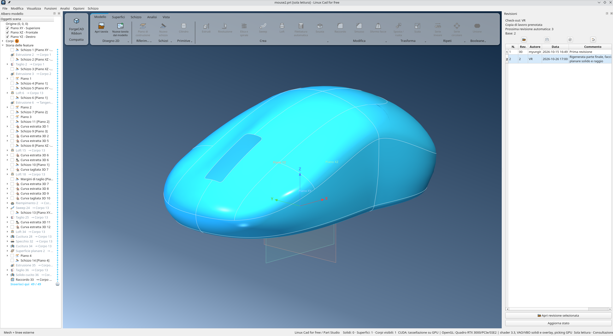
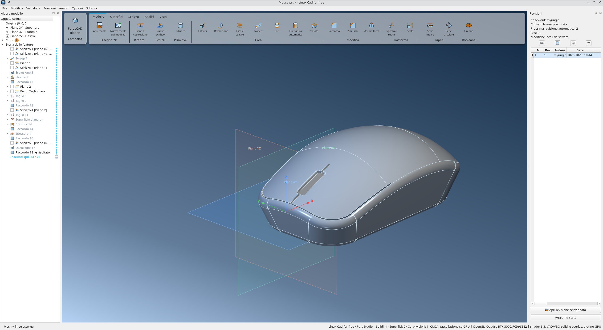
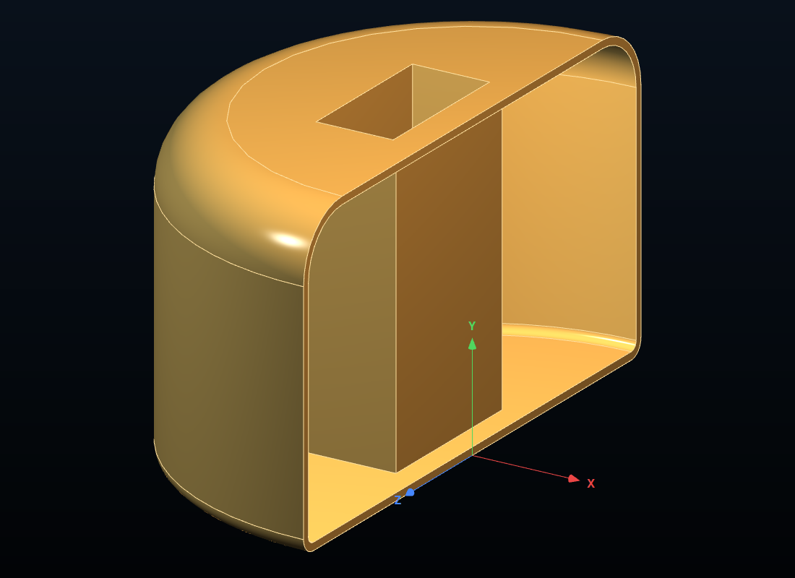
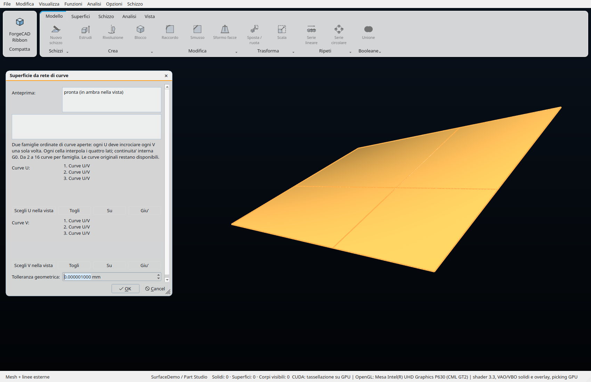
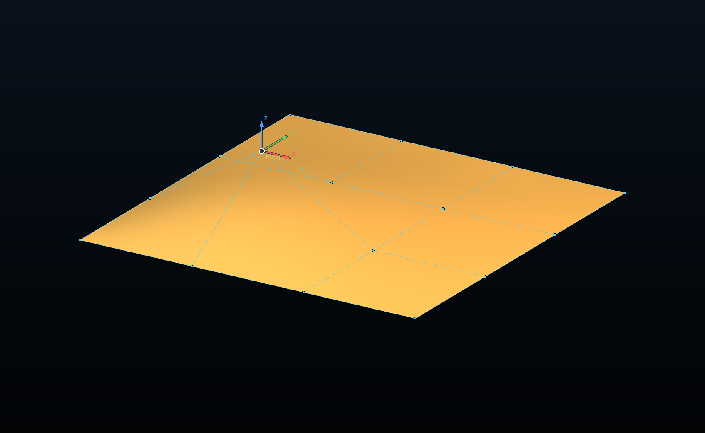
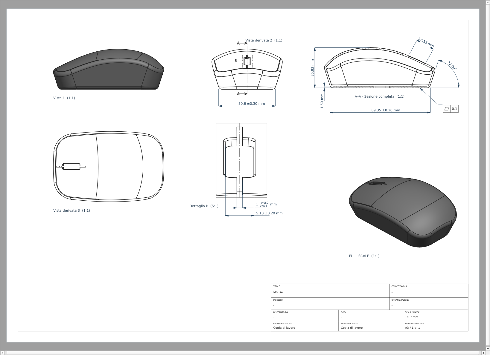

# ForgeCAD — CAD parametrico 3D per Linux e macOS

**Lingua:** [English](README.md) · Italiano

[](https://github.com/myungit-Vins-Prototype/Linux_CAD_forFree/actions/workflows/ci.yml)

Costruisci solidi parametrici e superfici a forma libera, modifica la storia delle operazioni e crea tavole tecniche 2D. ForgeCAD è un CAD gratuito e open source per Linux e macOS, con un kernel geometrico B-rep proprio.

**[Compila su Linux](#installazione-su-linux) · [Compila su macOS](#installazione-su-macos) · [Crea il primo modello](#primo-modello-e-comandi) · [Segnala un problema](https://github.com/myungit-Vins-Prototype/Linux_CAD_forFree/issues)**

[](docs/images/forgecad-3d.png)

*Modellazione di superfici, storia parametrica e revisioni nell’interfaccia di ForgeCAD.*

- **Disegna e vincola:** schizzi 2D, quote, vincoli geometrici e curve 3D.
- **Modella solidi e superfici:** estrusione, rivoluzione, Sweep, Loft, cucitura di superfici e modifica dei poli NURBS.
- **Rivedi il modello:** modifica i parametri delle funzioni e rigenera attraverso lo storyboard parametrico.
- **Crea tavole:** viste proiettate, sezioni, dettagli e quote.
- **Scambia geometria:** importa/esporta STEP e IGES; esporta STL e OBJ.

**Stato del progetto:** in sviluppo attivo, con interfaccia dell’applicazione in italiano. Il progetto è sviluppato con l’aiuto dell’intelligenza artificiale. Leggi i [limiti](#limiti-e-licenza) prima di affidarti al programma per un particolare flusso di lavoro.

Lo sviluppo è unificato su `main`. CUDA e Metal restano backend opzionali negli stessi sorgenti; gli esperimenti usano rami brevi e richiedono misure sui casi interessati prima dell’integrazione.

## Da dove iniziare

1. Installa le [dipendenze](#requisiti), quindi segui le istruzioni di compilazione dai sorgenti per [Linux](#installazione-su-linux) o [macOS](#installazione-su-macos).
2. Segui [Primo modello e comandi](#primo-modello-e-comandi) per disegnare uno schizzo vincolato ed estruderlo in un solido.
3. Salva il modello parametrico come documento ForgeCAD `.prt` oppure scegli un [formato di scambio](#formati-supportati) per altre applicazioni.

## Indice

- [Da dove iniziare](#da-dove-iniziare)
- [Galleria](#galleria)
- [Funzionalità](#funzionalità)
- [Formati supportati](#formati-supportati)
- [Requisiti](#requisiti)
- [Scaricare i sorgenti](#scaricare-i-sorgenti)
- [Installazione su Linux](#installazione-su-linux)
- [Installazione su macOS](#installazione-su-macos)
- [CUDA facoltativa](#cuda-facoltativa)
- [Primo modello e comandi](#primo-modello-e-comandi)
- [Esempi](#esempi)
- [Test e sviluppo](#test-e-sviluppo)
- [Risoluzione dei problemi](#risoluzione-dei-problemi)
- [Limiti e licenza](#limiti-e-licenza)

## Galleria

Schermate reali dell’applicazione. Fare clic sulle immagini per aprirle a piena risoluzione.

| Modellazione solida | Anteprima di una funzione |
|---|---|
| [](docs/images/forgecad-solid-modeling.png) | [](docs/images/forgecad-function-preview.png) |
| Costruzione del corpo con operazioni parametriche. | Controllo del risultato dello svuotamento prima della conferma. |

| Costruzione di superfici | Modifica dei poli NURBS |
|---|---|
| [](docs/images/forgecad-surface-network.png) | [](docs/images/forgecad-nurbs-poles.png) |
| Due famiglie di curve U/V definiscono la superficie. | Gabbia di controllo e spostamento dei poli lungo gli assi. |

[](docs/images/forgecad-2d.png)

Tavola 2D con viste proiettate, sezione, dettaglio quotato e vista isometrica.

## Funzionalità

### Schizzi 2D e curve 3D

- Schizzi sui piani XY, XZ e YZ, su piani di costruzione e sulle facce piane dei corpi.
- Linee, polilinee, linee di costruzione, cerchi, ellissi e poligoni con numero di lati configurabile.
- Rettangoli per due angoli o dal centro, con possibilità di disegnare quadrati.
- Asola rettilinea: due centri e larghezza, con segmenti e archi tangenti vincolati; punti autonomi selezionabili, trascinabili e quotabili, esclusi dai profili. Vedi [strumenti dello schizzo](docs/sketch-tools.md).
- Archi da centro e estremi, per tre punti e tangenti a segmenti o archi.
- Spline per punti e NURBS; modifica di punti e maniglie, inserimento e rimozione dei punti di controllo.
- Opzioni per uniformare la curvatura delle spline, rilassare la curva e limitare le oscillazioni.
- Taglio, estensione, divisione, raccordo e smusso delle entità dello schizzo.
- Offset delle entità e delle catene; spostamento, rotazione e copia.
- Ripetizioni lineari e circolari e specchio delle entità dello schizzo.
- Snap alla geometria, alla griglia e all'origine; riconoscimento di punti medi e quadranti.
- Riferimenti esterni ad assi, piani, spigoli e curve; conversione degli spigoli e sezioni dei corpi nel piano dello schizzo.
- **Schizzi 3D** con polilinee e spline definite da punti XYZ nello spazio.
- Estrazione associativa di bordi 3D, taglio delle curve 3D e proiezione di curve sulle superfici.
- Eliche e spirali utilizzabili come percorsi di modellazione.

### Quote e vincoli

- Quote di lunghezza, distanza orizzontale/verticale, angolo, raggio e diametro, anche rispetto a un asse.
- Coincidenza, orizzontalità, verticalità, parallelismo, perpendicolarità e collinearità.
- Tangenza, uguaglianza, concentricità, simmetria, punto medio, quadrante, punto sull'entità, *pierce* su superficie e geometria fissa.
- Vincoli associati a offset e ripetizioni.
- Pannello dei vincoli, gradi di libertà e indicazione dello stato completamente definito dello schizzo.
- Modifica delle quote tramite doppio clic e posizionamento grafico delle annotazioni.
- Campi numerici con espressioni: `25/2`, `3*(4+1.5)`, `sqrt(2)*10`, `360/7`. Sono disponibili operatori `+ - * / ^`, parentesi, `pi`, `sqrt`, `abs`, funzioni trigonometriche in gradi, `exp`, `ln` e `log`. Il separatore decimale può essere punto o virgola.
- Unità del documento: millimetri, centimetri, metri, pollici e piedi.

### Modellazione solida

| Operazione | Descrizione |
|---|---|
| Primitive | Parallelepipedo, cilindro, sfera, cono e toro |
| Estrusione | Costruzione da schizzo, estrusione in un verso, simmetrica o in due versi e taglio del corpo |
| Rivoluzione | Geometria ottenuta ruotando un profilo attorno a un asse |
| Booleane | Unione, intersezione e differenza A − B |
| Sweep | Profilo lungo un percorso, con riferimenti a schizzi e curve/bordi 3D |
| Loft | Collegamento di sezioni con guide e controllo delle condizioni ai profili |
| Raccordo e smusso | Lavorazione degli spigoli, anche scegliendo i bordi di una faccia |
| Sformo | Inclinazione delle facce |
| Svuotamento | Creazione di un corpo cavo |
| Filettatura automatica | Creazione della feature di filettatura |
| Ripetizioni e specchio | Copie lineari, circolari e speculari di corpi solidi o di superficie |
| Trasformazioni | Spostamento, rotazione e scala dei corpi |
| Piani di costruzione | Riferimenti per nuovi schizzi e operazioni |

Il Loft accetta sezioni e guide da schizzi e bordi esatti, anche spaziali, con elenchi ordinabili e riferimenti associativi. Le condizioni G0/G1/G2 disponibili dipendono dal comando e dalla geometria: contatto, tangenza e curvatura richiedono riferimenti compatibili.

### Modellazione di superfici

- Estrusione di profili aperti, Loft di superfici e Sweep di superfici.
- Superfici planari, rigate, tra curve e di riempimento.
- Selezione di bordi e curve per definire contorni, sezioni e guide.
- Copia e rimozione di facce.
- Offset, estensione e taglio delle superfici.
- **Estendi fino a riferimento**: un bordo libero prosegue fino a un piano o a una faccia, anche curva, entro una distanza massima di ricerca.
- **Superficie da rete di curve**: due famiglie ordinate U/V, con un solo incrocio 3D per coppia, generano celle di Coons cucite con continuità interna G0.
- Riempimenti con continuità **G0/G1/G2 per singola faccia adiacente**, ereditabile dall'impostazione comune; influenza e guida della forma restano associate alla faccia.
- **Modifica poli NURBS**: gabbia selezionabile e trascinabile nella vista, tabella XYZ e pesi; modifiche parametriche relative alla sorgente.
- Cucitura di più superfici; creazione di un solido quando chiudono un volume valido.
- Aggiunta di spessore per trasformare superfici in solidi.
- Ripetizione lineare, circolare e specchio delle superfici.

I nuovi comandi sono nel menu **Funzioni → Superfici**. Le reti accettano 2–16 curve aperte per famiglia; riordinare le curve con Su/Giù quando gli incroci non sono monotoni. Non è una superficie globale Gordon con G1/G2 fra le celle. L'estensione richiede che il riferimento attraversi tutto il prolungamento senza tagliare la superficie iniziale; aumentare la distanza di ricerca se necessario.

L'editor dei poli lavora su una singola faccia NURBS e conserva gradi, nodi e rifilature UV, inclusi i fori. Per una faccia di un corpo cucito usare prima **Copia facce**. Il trascinamento avviene sul piano dello schermo; per il terzo asse usare la tabella o ruotare la vista. Pesi positivi, griglia fino a 4096 poli. Se la struttura della griglia cambia a monte, ricaricare la griglia e riselezionare i poli. I controlli di regolarità sono campionati e non certificano l'assenza globale di auto-intersezioni. Le nuove funzioni partecipano a rigenerazione, Undo/Redo, salvataggio e revisioni; il formato nativo 54 conserva i nomi topologici degli appoggi degli schizzi e dei vincoli Pierce e legge i formati precedenti.

### Storia parametrica e documenti

- Storyboard con schizzi, feature e corpi; selezione sincronizzata con la vista 3D.
- Modifica dei parametri delle operazioni e rigenerazione del modello.
- Spostamento delle feature nella storia nel rispetto delle dipendenze.
- Soppressione e riattivazione delle feature; cursore per lavorare in una posizione della storia.
- Selezione multipla, rinomina, visibilità e cancellazione di oggetti e feature.
- Evidenziazione delle facce di una feature o di un intero corpo.
- Annulla/ripeti per le modifiche al documento.
- Grafo delle dipendenze tramite **Visualizza → Debug history / storyboard**.
- Salvataggio delle definizioni parametriche e, facoltativamente, dei corpi già calcolati per accelerare la riapertura.
- Blocco esclusivo dei documenti aperti e salvataggio tramite file temporaneo per proteggere la scrittura.

### Tavole 2D

Viste proiettate, sezioni, dettagli e ausiliarie; viste interrotte orizzontali o verticali con anteprima e quote del modello completo. Vedi [viste interrotte](docs/drawing-breaks.md) per uso e limiti. I dettagli circolari, rettangolari o a polilinea possono essere collegati alla vista madre con una linea che segue gli spostamenti.

### Visualizzazione e analisi

ForgeCAD è scritto in **C++17** con **Qt 6** e una viewport **OpenGL 3.3 Core**. L’interfaccia usa lo stile comune Fusion e due palette dell’app, chiara e scura. Segue la scelta chiaro/scuro del sistema, mantenendo lo stesso disegno dei controlli tra le piattaforme. Il riconoscimento dello schema usa Qt 6.5+; sui backend precedenti dipende dalle notifiche della palette di sistema.

- Rotazione, pan, zoom e inquadratura della scena.
- Modalità filo di ferro, ombreggiata e ombreggiata con bordi.
- Visualizzazione e selezione dei bordi nascosti; identificativi topologici di facce e bordi.
- Vista in sezione con parametri modificabili.
- Griglia, piani e assi configurabili, anche in primo piano.
- Qualità della tassellazione bassa, media o alta; antialiasing MSAA.
- Illuminazione Studio, Morbida e Ispezione; sfondo, luce ambiente e colori personalizzabili.
- Trasparenza dei corpi nello schizzo e personalizzazione dei pannelli delle funzioni.
- Misura della geometria selezionata.
- Proprietà geometriche e di massa: volume, area, lunghezza, baricentro, tensore d'inerzia e momenti principali, secondo il tipo di geometria.
- Analisi di curvatura, zebra, continuità delle giunzioni e pettini di curvatura di curve e superfici.
- Analisi delle micro-geometrie.
- Tassellazione con CUDA quando compilata e disponibile; percorso CPU in assenza di CUDA.

## Formati supportati

| Formato | Apertura / importazione | Salvataggio / esportazione |
|---|---|---|
| `.prt` di ForgeCAD | Documento nativo con storia parametrica | Documento nativo |
| STEP (`.step`, `.stp`) | Importazione della geometria | AP242, AP214 e AP203 |
| IGES (`.igs`, `.iges`) | Importazione della geometria | IGES 5.3: solidi (186) e superfici (144) |
| STL | — | Mesh triangolare |
| OBJ | — | Mesh quadrangolare, per esempio per Blender |

Dal formato 56 i nuovi salvataggi usano Zstandard con checksum per definizione e cache, senza perdere precisione geometrica o mesh; richiedono un lettore aggiornato. I file precedenti zlib (1–55) restano leggibili.

I documenti `.prt` di ForgeCAD hanno una firma interna `FCAD`: l'estensione non indica compatibilità con i documenti di altri CAD. STEP e IGES trasferiscono la geometria senza ricreare lo storyboard parametrico originale. Le esportazioni STEP/IGES usano i corpi visibili.

## Requisiti

| Componente | Requisito |
|---|---|
| Sistema | Linux con sessione grafica oppure macOS |
| Compilatore | C++17, GCC o Clang; su macOS anche Objective-C++ e AppKit |
| CMake | 3.21 o successivo |
| Qt | Qt 6 con Widgets, OpenGL e OpenGLWidgets, inclusi i file di sviluppo |
| Grafica | Driver e contesto desktop OpenGL 3.3 Core |
| OpenCASCADE / OCCT | File di sviluppo e configurazione CMake, richiesti per i test dalla build attuale |
| CUDA | Facoltativa, per la tassellazione su GPU NVIDIA |

L'applicazione e il kernel proprio non collegano OpenCASCADE per la modellazione o lo scambio STEP/IGES. Tuttavia, i `CMakeLists.txt` attuali richiedono OCCT e configurano i test di confronto anche quando si compila solo il target `forgecad`.

Le istruzioni seguenti descrivono una compilazione dai sorgenti. Usare una cartella di build nuova su ogni macchina, evitando cache CMake e binari provenienti da un altro sistema.

## Scaricare i sorgenti

Da GitHub usare **Code → Download ZIP** ed estrarre il progetto, oppure clonare il repository. I comandi seguenti creano una directory locale chiamata `Linux_CAD_forFree`:

```sh
git clone https://github.com/myungit-Vins-Prototype/Linux_CAD_forFree.git Linux_CAD_forFree
cd Linux_CAD_forFree
```

Se il repository viene rinominato o trasferito, usare l'URL del pulsante **Code** sulla sua pagina GitHub.

## Installazione su Linux

### 1. Dipendenze

**Ubuntu / Debian**, con Qt 6 e OCCT disponibili nei repository:

```sh
sudo apt update
sudo apt install build-essential cmake git qt6-base-dev libqt6opengl6-dev zlib1g-dev libzstd-dev \
  libgl1-mesa-dev libocct-foundation-dev libocct-modeling-data-dev \
  libocct-modeling-algorithms-dev libocct-data-exchange-dev \
  libocct-visualization-dev
```

Su Ubuntu alcuni pacchetti si trovano nel repository **Universe**. Su Wayland aggiungere `qt6-wayland`, se disponibile per la distribuzione.

**Arch Linux / distribuzioni compatibili con pacman:**

```sh
sudo pacman -S --needed base-devel cmake git qt6-base opencascade mesa zlib zstd
```

Su Wayland aggiungere `qt6-wayland`. Per altre distribuzioni installare gli equivalenti di compilatore C++, CMake, Qt 6, OpenGL, zlib, Zstandard e OCCT con i file di sviluppo. zlib serve alla decompressione incrementale dei documenti con controlli sui limiti di memoria.

Riferimenti: [Qt/OpenGL su Ubuntu](https://packages.ubuntu.com/jammy/libqt6opengl6-dev), [OCCT su Ubuntu](https://packages.ubuntu.com/search?keywords=libocct-data-exchange-dev&suite=noble), [Qt su Arch](https://archlinux.org/packages/extra/x86_64/qt6-base/) e [OCCT su Arch](https://archlinux.org/packages/extra/x86_64/opencascade/).

### 2. Compilazione e avvio

Dalla directory dei sorgenti:

```sh
cmake -S . -B build-linux -DCMAKE_BUILD_TYPE=Release
cmake --build build-linux --target forgecad --parallel 2
./build-linux/forgecad
```

`--parallel 2` limita il consumo di memoria; aumentare il numero su macchine con risorse sufficienti. Per aprire un documento esistente, sostituire il percorso seguente con quello del proprio file:

```sh
./build-linux/forgecad "/percorso/del/proprio/modello.prt"
```

### 3. Integrazione desktop o installazione di sistema

Lo script incluso aggiunge per l'utente corrente la voce del menu, le icone e l'associazione dei documenti ForgeCAD `.prt`, senza root:

```sh
sh packaging/linux/install-desktop-integration.sh "$PWD/build-linux/forgecad"
```

Il collegamento punta al binario compilato: dopo aver spostato la cartella ripetere l'integrazione con il nuovo percorso. Le utility `xdg-mime`, `update-mime-database` e `update-desktop-database` aggiornano le associazioni; installare i pacchetti corrispondenti della distribuzione se necessario.

In alternativa, installare binario e integrazione desktop a livello di sistema:

```sh
sudo cmake --install build-linux --prefix /usr/local
forgecad
```

Disinstallazione dell'integrazione dell'utente:

```sh
sh packaging/linux/uninstall-desktop-integration.sh
```

Disinstallazione dell'installazione di sistema con il prefisso precedente:

```sh
sudo sh packaging/linux/uninstall-desktop-integration.sh --system /usr/local
```

Ulteriori dettagli in [packaging/linux/README.md](packaging/linux/README.md).

## Installazione su macOS

### 1. Strumenti e dipendenze

Installare gli strumenti da riga di comando Apple:

```sh
xcode-select --install
```

Installare [Homebrew](https://brew.sh/) seguendo le istruzioni ufficiali, quindi:

```sh
brew install cmake qt opencascade zstd
```

Le formule ufficiali sono [Qt](https://formulae.brew.sh/formula/qt) e [OpenCASCADE](https://formulae.brew.sh/formula/opencascade). Usare compilatore e librerie della stessa architettura: arm64 su Apple Silicon oppure x86_64 su Intel.

CMake richiede anche zlib, disponibile nell'SDK installato con i Command Line Tools di Xcode.

### 2. Compilazione e avvio

Dalla directory dei sorgenti:

```sh
cmake -S . -B build-macos \
  -DCMAKE_BUILD_TYPE=Release \
  -DCMAKE_PREFIX_PATH="$(brew --prefix qt);$(brew --prefix opencascade)"
cmake --build build-macos --target forgecad --parallel 2
./build-macos/forgecad
```

`brew --prefix` risolve i percorsi delle dipendenze per Homebrew. La build macOS include l'integrazione nativa dei menu tramite AppKit. Metal accelera la valutazione B-spline/NURBS nei lotti di almeno 8.192 punti; rifilatura e triangolazione restano CPU. L’opzione «Tassellazione con Metal» abilita il percorso, con ritorno automatico alla CPU per lotti piccoli, GPU assente o dati mal condizionati.

Per aprire un documento esistente, sostituire il percorso seguente con quello del proprio file:

```sh
./build-macos/forgecad "/percorso/del/proprio/modello.prt"
```

La configurazione attuale genera un **eseguibile da avviare dal Terminale**. Non crea un bundle `.app` autonomo né un installer `.dmg`; le librerie Homebrew devono rimanere installate. Gli script di integrazione desktop della sezione Linux sono destinati a Linux.

## CUDA facoltativa

Su Linux CMake cerca automaticamente un compilatore CUDA e controlla anche `/opt/cuda/bin/nvcc`. Se lo trova compila il supporto CUDA, altrimenti usa il percorso CPU.

Servono un toolkit compatibile con il compilatore C++, il driver NVIDIA e una GPU supportata. L'opzione è in **Opzioni → Tassellazione con CUDA**. CUDA accelera la valutazione/tassellazione delle superfici, senza sostituire l'intera modellazione geometrica sulla CPU.

Su una macchina senza compilatore CUDA, i normali comandi producono una build CPU. Per escludere esplicitamente CUDA anche quando il toolkit è installato, configurare con `-DFORGECAD_ENABLE_CUDA=OFF`. Il valore predefinito `ON` rileva automaticamente il toolkit; disattivare CUDA nell’interfaccia cambia solo il percorso a runtime. Su macOS il backend Metal rimane disponibile indipendentemente da CUDA.

## Primo modello e comandi

1. Avviare ForgeCAD e scegliere **File → Nuovo**.
2. Impostare le unità da **Opzioni → Unità di misura del documento**.
3. Creare uno schizzo da **Schizzo → Nuovo schizzo**, scegliendo un piano.
4. Disegnare un rettangolo o un altro profilo chiuso, aggiungendo quote e vincoli.
5. Terminare la modalità schizzo e scegliere **Funzioni → Estrusione**.
6. Impostare la lunghezza e confermare: corpo e feature compaiono nello storyboard.
7. Riaprire lo schizzo o i parametri della feature per modificare il modello. Usare **Modifica → Rigenera tutto** quando necessario.
8. Salvare in `.prt` oppure esportare la geometria per altri programmi.

### Interazione e scorciatoie

- Clic per selezionare; `Ctrl` o `Maiusc` per aggiungere/togliere elementi alla selezione.
- Pulsante centrale trascinato, oppure `Spazio` + trascinamento sinistro, per il pan. Il tasto è personalizzabile in **Opzioni → Tasto per il pan**.
- Rotella per lo zoom; `+` e `−` per aumentarlo o ridurlo; `0` per inquadrare la scena.
- Doppio clic sullo schizzo per modificarlo; menu contestuale su feature e corpi per parametri e visibilità.
- `F2` per rinominare nell'albero, `Canc` per eliminare, `Esc` per interrompere lo strumento o chiudere il pannello attivo.

| Azione | Scorciatoia su Linux |
|---|---|
| Nuovo / Apri / Salva | `Ctrl+N` / `Ctrl+O` / `Ctrl+S` |
| Annulla / Ripeti | `Ctrl+Z` / `Ctrl+Shift+Z` oppure `Ctrl+Y` |
| Importa STEP/IGES | `Ctrl+I` |
| Rigenera tutto | `Ctrl+B` |
| Estrusione / Rivoluzione | `Ctrl+E` / `Ctrl+R` |
| Piano di costruzione | `Ctrl+Shift+P` |
| Proprietà di massa / Misura | `Ctrl+M` / `Ctrl+Shift+M` |
| Mostra tutti gli oggetti | `Ctrl+Shift+H` |
| Vista in sezione | `Ctrl+Shift+X` |
| Quota nello schizzo | `D` |
| Taglia / Estendi / Spezza nello schizzo | `T` / `E` / `S` |
| Raccordo / Smusso nello schizzo | `R` / `M` |

Su macOS le scorciatoie standard seguono le convenzioni di Qt e del sistema. Consultare le combinazioni mostrate nei menu per ciascun comando.

## Esempi

Le schermate sopra mostrano modelli creati in ForgeCAD. I documenti CAD di esempio non sono inclusi nei sorgenti. Per provare l’applicazione senza file esterni, seguire [Primo modello e comandi](#primo-modello-e-comandi).

Se si dispone di una raccolta locale di modelli, aprire un documento con **File → Apri** e usare **Salva con nome** per sperimentare su una copia. I test che richiedono documenti reali possono usare una directory di esempi esterna; vedi [Test e sviluppo](#test-e-sviluppo).

## Test e sviluppo

La [CI GitHub Actions](docs/ci.md) compila l'applicazione completa ed esegue le
suite CTest autosufficienti su Ubuntu 26.04 e macOS 15 a ogni push e pull request.
I test viewport con documenti esterni e le prove GPU/rendering nativo restano
separati; il badge mostra il risultato complessivo del workflow.

Il target `forgecad` produce l'applicazione. Per compilare anche i test configurati ed eseguirli:

```sh
cmake --build build-linux --parallel 2
ctest --test-dir build-linux --output-on-failure
```

Su macOS sostituire `build-linux` con `build-macos`. Per aggiungere le prove delle interazioni del viewport:

```sh
cmake -S . -B build-linux -DFORGECAD_BUILD_VIEW_TESTS=ON
cmake --build build-linux --parallel 2
ctest --test-dir build-linux --output-on-failure
```

La stessa opzione può essere aggiunta alla configurazione macOS mantenendo i parametri Homebrew. I test del viewport registrati in CTest usano Qt offscreen; le verifiche OpenGL richiedono un ambiente grafico adatto. I test CUDA sono configurati solo quando è disponibile il compilatore CUDA.

Le prove su documenti reali richiedono i file di esempio. Se sono conservati fuori dal checkout, configurare `-DFORGECAD_EXAMPLE_DIR=/percorso/degli/esempi`: CTest usa questo percorso anche se la variabile d'ambiente omonima è diversa. Nei lanci diretti del runner si può invece impostare la variabile d'ambiente `FORGECAD_EXAMPLE_DIR`. I test salvano le copie nelle cartelle temporanee e conservano gli originali.

La mappa architetturale interattiva (`docs/architecture/index.html`, generata localmente), consultabile offline, raggruppa i file per responsabilità e mostra chiamate C++, include e riferimenti a funzione in entrambi i versi. [Guida a generazione e copertura](docs/architecture/README.md). Avviare `python3 tools/open_architecture.py` per **aggiornare la mappa a ogni apertura o ricaricamento** e consultarla nel browser. La build CMake esporta `compile_commands.json`, ma non avvia l’analisi della mappa; Python 3 e i binding libclang servono soltanto per aggiornarla. Rivedere le descrizioni curate dopo modifiche strutturali e verificare con `python3 tools/generate_architecture.py --check`, come richiesto in `AGENTS.md`.

| Percorso | Contenuto |
|---|---|
| `forgeCad2026.cpp` | Avvio e configurazione OpenGL |
| `forgeCad2026_gui.h/.cpp` | Finestra principale; sette fasi di inizializzazione per scena, menu, comandi, opzioni e toolbar |
| `forgeCad2026_viewport.h/.cpp`, `forgeCad2026_viewport_*.cpp` | Coordinatore GUI privato, con implementazioni per documento, interazione, selezione, sketch, anteprime, rendering e scena |
| `forgeCad2026_feature_preview.h/.cpp` | Chiave e calcolo anteprime su snapshot; ciclo asincrono GUI nel viewport |
| `forgeCad2026_sketch_curvature.h/.cpp` | Cache dei pettini di curvatura con stato e invalidazione propri |
| `forgeCad2026_camera.h/.cpp` | Stato camera e calcoli di vista, proiezione, raggi e orbita senza dipendenze dal widget |
| `forgeCad2026_glass_compositor.h/.cpp` | Compositore OpenGL dei fondali sfocati dei pannelli, con shader e framebuffer propri |
| `forgeCad2026_gpu_picker.h/.cpp` | Buffer del picking GPU: cache per frame, lettura degli identificativi e risorse proprie |
| `forgeCad2026_scene_renderer.h/.cpp` | Passata della scena OpenGL: fondale, framebuffer MSAA, risoluzione, opacita', linee di analisi, assi/griglia/piani di riferimento e passata datum, sezioni 3D, anteprime, corpi ed evidenziazioni di selezione/topologia |
| `cad_display_cache.h/.cpp` | Cache GPU e disegno di facce, spigoli e contorni dei display, comprese le istanze |
| `forgeCad2026_gui_common.h/.cpp` | Helper grafici condivisi da finestra e viewport |
| `forgeCad2026_storyboard.h/.cpp` | Albero storyboard, badge e cursore della storia |
| `forgeCad2026_dialogs.h`, `forgeCad2026_dialogs_*.cpp` | Dialoghi raggruppati per solidi, superfici, schizzi/curve e analisi |
| `forgeCad2026_dialogs_common.h/.cpp` | Pannelli, anteprime e selettori di riferimenti condivisi |
| `cad_*.cpp`, `cad_*.h` | Schizzi, vincoli, feature, storia, documenti, analisi e scambio file |
| `kernel/` | Kernel geometrico, B-rep, curve/superfici e test numerici |
| `tests/` | Test dell'applicazione e delle interazioni |
| `packaging/` | Integrazione Linux e metadati macOS |
| `icons/` | Icone e risorse |
| `docs/` | Note tecniche e documentazione delle prestazioni |
| Directory di esempi esterna | Modelli CAD locali, non inclusi nel repository |

La [politica delle tolleranze](docs/tolerance-policy.md) definisce risoluzione, budget di connessione e approssimazione, tolleranze locali e controlli di validita'.

## Risoluzione dei problemi

**CMake non trova Qt 6 o OpenCASCADE.** Installare i pacchetti di sviluppo. Per percorsi personalizzati passare `-DCMAKE_PREFIX_PATH="/prefisso/qt;/prefisso/occt"`, oppure `Qt6_DIR` e `OpenCASCADE_DIR` con le directory contenenti i rispettivi `*Config.cmake`. Su macOS usare la configurazione Homebrew sopra.

**Cache CMake di un'altra macchina o compilatore.** Configurare una nuova cartella di build.

**Memoria insufficiente durante la compilazione.** Ridurre il parallelismo a `--parallel 1`.

**CUDA rilevata, ma configurazione o compilazione falliscono.** Verificare la compatibilità tra toolkit, compilatore e GPU; se necessario specificare un'architettura supportata con `-DCMAKE_CUDA_ARCHITECTURES=...`. Il percorso CPU viene selezionato automaticamente su una macchina senza compilatore CUDA; leggere la sezione CUDA per il comportamento del rilevamento attuale.

**Problemi grafici su Wayland.** Verificare il plugin Qt Wayland e i driver. Con XWayland disponibile, provare come diagnostica:

```sh
QT_QPA_PLATFORM=xcb ./build-linux/forgecad
```

**Problemi su un portatile Linux con GPU Intel + NVIDIA.** L'applicazione tenta di preferire NVIDIA quando rileva la configurazione EGL del driver. Per provare la GPU integrata:

```sh
FORGECAD_IGPU=1 ./build-linux/forgecad
```

**Modello diverso dopo un aggiornamento.** Usare **Modifica → Rigenera tutto**. I documenti possono contenere corpi e mesh già calcolati; la rigenerazione aiuta a diagnosticare riferimenti mancanti e feature non valide.

**Documento già aperto.** ForgeCAD usa un file `.lock` per evitare scritture concorrenti. Chiudere l'altra istanza che lo sta usando prima di modificarlo.

Per segnalare un problema su GitHub indicare sistema operativo, architettura, versioni di Qt/CMake/OCCT, GPU, errore e passaggi per riprodurlo. Allegare un modello minimo condivisibile quando possibile.

## Limiti e licenza

Le operazioni geometriche e lo scambio STEP/IGES dipendono dalle entità supportate dal kernel proprio; non è garantita la compatibilità con ogni file o configurazione geometrica. Le istruzioni di installazione sono ricavate dalla configurazione del progetto e non certificano il funzionamento su tutte le versioni di Linux e macOS.

Il progetto è distribuito con licenza **GNU General Public License v3 (GPLv3)**. Il testo completo è nel file [LICENSE](LICENSE), identico a quello del branch `main`. Le dipendenze mantengono le rispettive licenze.
