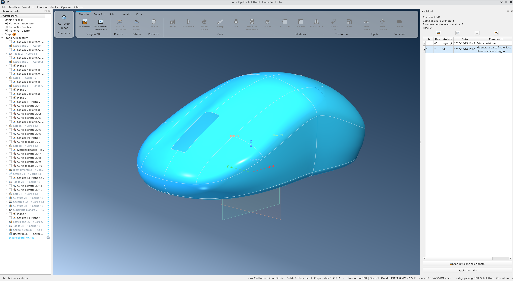
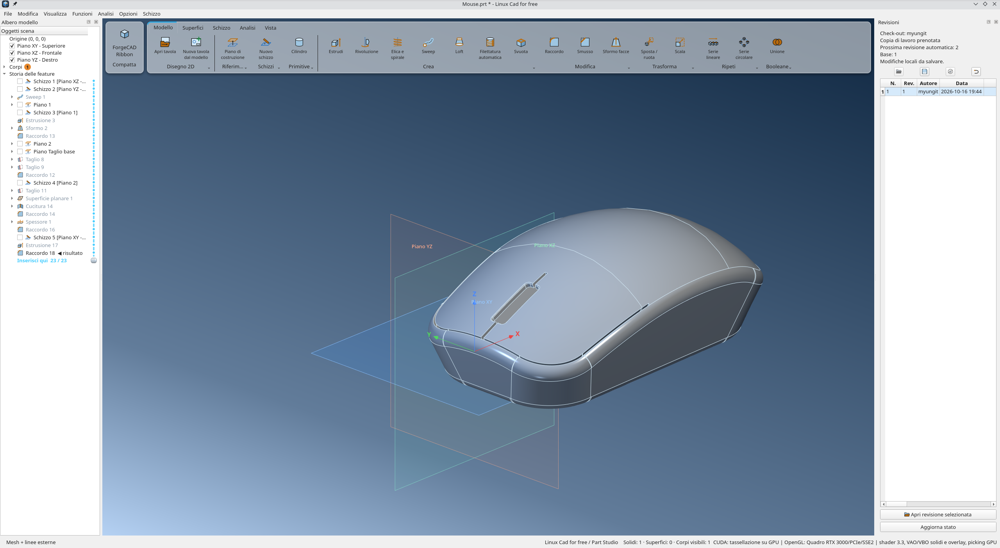
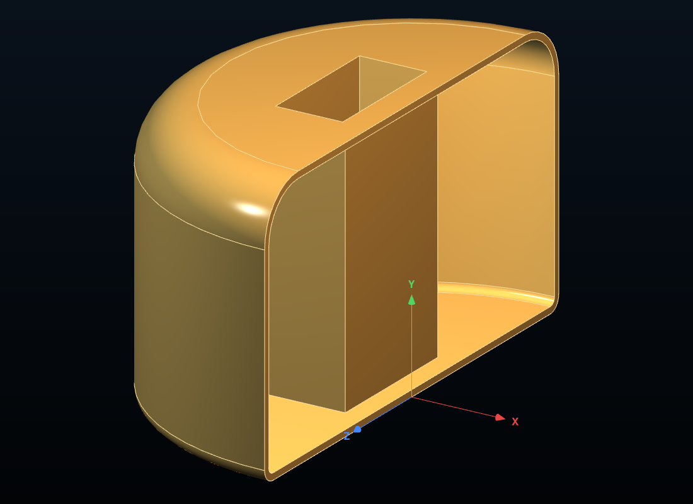
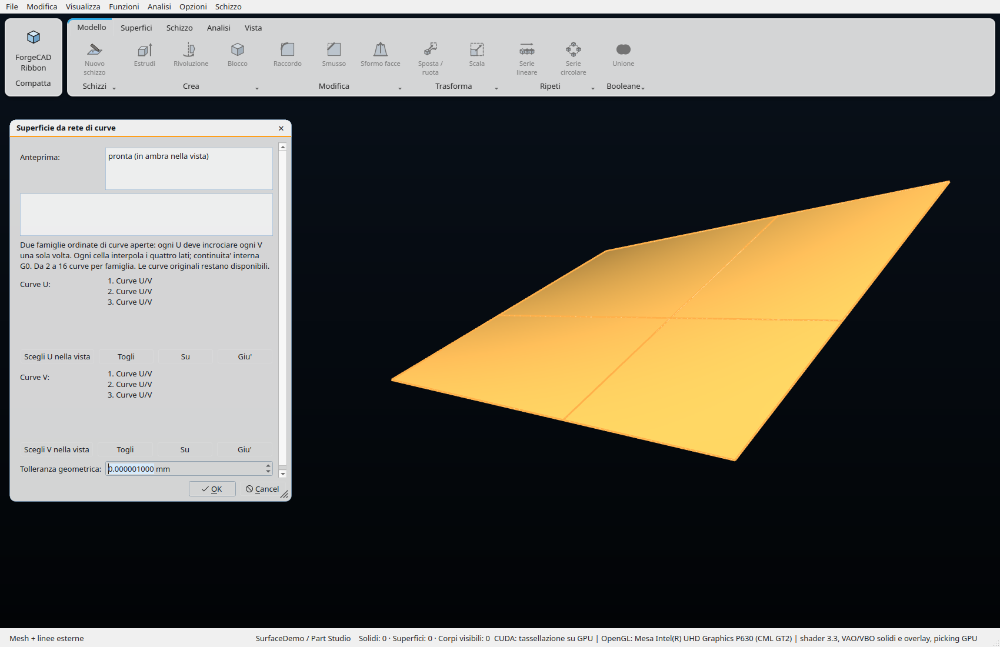
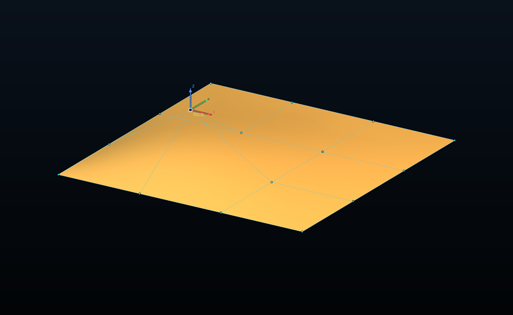
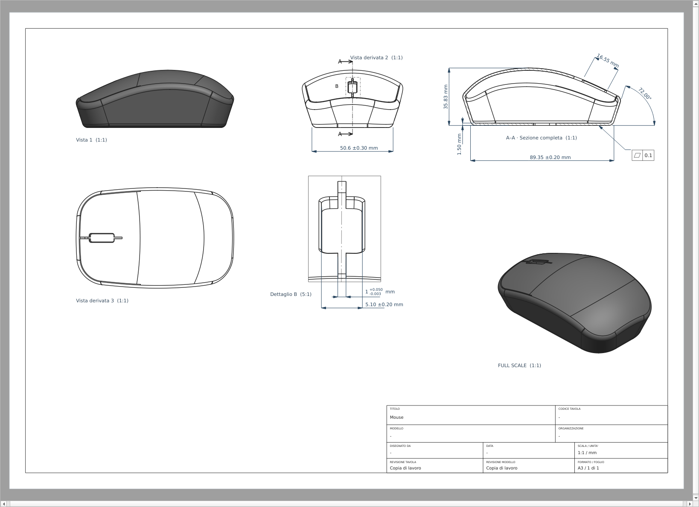

# ForgeCAD — Parametric 3D CAD for Linux and macOS

**Language:** English · [Leggi in italiano](README.it.md)

[](https://github.com/myungit-Vins-Prototype/Linux_CAD_forFree/actions/workflows/ci.yml)

Build parametric solids and freeform surfaces, edit their modeling history, and create 2D technical drawings. ForgeCAD is a free, open-source CAD application for Linux and macOS with its own B-rep geometry kernel.

**[Build on Linux](#installing-on-linux) · [Build on macOS](#installing-on-macos) · [Create your first model](#your-first-model-and-controls) · [Report a problem](https://github.com/myungit-Vins-Prototype/Linux_CAD_forFree/issues)**

[](docs/images/forgecad-3d.png)

*Surface modeling, parametric history, and revisions in the ForgeCAD interface.*

- **Sketch and constrain:** 2D sketches, dimensions, geometric constraints, and 3D curves.
- **Model solids and surfaces:** extrude, revolve, sweep, loft, sew surfaces, and edit NURBS control points.
- **Revise the model:** change feature parameters and rebuild through the parametric storyboard.
- **Create drawings:** projected views, sections, details, and dimensions.
- **Exchange geometry:** import/export STEP and IGES; export STL and OBJ.

**Project status:** under active development, with an Italian-language application interface. This project is developed with the help of artificial intelligence. The English guide retains Italian menu labels so you can find the commands in the application. Read the [limitations](#limitations-and-license) before relying on it for a particular workflow.

Development is unified on `main`. CUDA and Metal remain optional backends in the same source tree; experiments use short-lived branches and require workload-specific measurements before integration.

Feature status and next increments: [project roadmap (Italian)](docs/roadmap.md).

## Get started

1. Install the [dependencies](#requirements), then follow the source build instructions for [Linux](#installing-on-linux) or [macOS](#installing-on-macos).
2. Follow [Your first model](#your-first-model-and-controls) to draw a constrained sketch and extrude it into a solid.
3. Save the parametric model as a ForgeCAD `.prt` document, or choose an [exchange format](#supported-formats) for other applications.

## Contents

- [Get started](#get-started)
- [Gallery](#gallery)
- [Features](#features)
- [Supported formats](#supported-formats)
- [Requirements](#requirements)
- [Getting the source](#getting-the-source)
- [Installing on Linux](#installing-on-linux)
- [Installing on macOS](#installing-on-macos)
- [Optional CUDA support](#optional-cuda-support)
- [Your first model and controls](#your-first-model-and-controls)
- [Examples](#examples)
- [Tests and development](#tests-and-development)
- [Troubleshooting](#troubleshooting)
- [Limitations and license](#limitations-and-license)

## Gallery

Screenshots from the application. Click the images to view them at full resolution.

| Solid modeling | Feature preview |
|---|---|
| [](docs/images/forgecad-solid-modeling.png) | [](docs/images/forgecad-function-preview.png) |
| Building a body through parametric operations. | Inspecting the shell result before confirming the operation. |

| Surface construction | NURBS control point editing |
|---|---|
| [](docs/images/forgecad-surface-network.png) | [](docs/images/forgecad-nurbs-poles.png) |
| Two U/V curve families define the surface. | Moving control points using the cage and axis handles. |

[](docs/images/forgecad-2d.png)

2D drawing with projected views, a section, a dimensioned detail and an isometric view.

## Features

### 2D sketches and 3D curves

- Sketches on the XY, XZ, and YZ planes, construction planes, and planar body faces.
- Lines, polylines, construction lines, circles, ellipses, and polygons with a configurable number of sides.
- Rectangles defined by two corners or by their center, with an option to draw squares.
- Straight slots defined by two end centers and their width, with constrained tangent lines and arcs; independent points support selection, dragging and dimensions, and are excluded from profiles. See [sketch tools](docs/sketch-tools.md) (Italian).
- Arcs defined by a center and endpoints, three-point arcs, and arcs tangent to lines or other arcs.
- Interpolating splines and NURBS; editing points and handles, and inserting or removing control points.
- Options to make spline curvature continuous, relax curves, and limit oscillations.
- Trimming, extending, splitting, filleting, and chamfering sketch entities.
- Offsetting entities and chains; moving, rotating, and copying.
- Linear and circular patterns and mirroring of sketch entities.
- Snapping to geometry, the grid, and the origin; midpoints, quadrants, and **Intersezione** (intersection) between exact curves. Intersection constraints follow both source entities; extensions and overlaps without an isolated crossing do not produce an intersection snap.
- External references to axes, planes, edges, sketches, and curves, including projected and extracted curves; edge conversion and body sections in the sketch plane. Clicks and hovering remain temporary: automatic references are stored only when used and cleaned up when their last use is deleted, preserving constraints, explicit conversions, and Undo/Redo.
- **Visualizza → Mostra linee di costruzione** (View → Show construction lines) also displays construction geometry outside sketch editing; the preference is saved. Construction geometry is excluded from modeling profiles.
- A newly created sketch is discarded when closed without completed entities; points and construction geometry count as content. Existing sketches and sketches used by other features are preserved.
- **3D sketches** with polylines and splines defined by XYZ points in space.
- Associative extraction of 3D edges, trimming of 3D curves, and projection of curves onto surfaces.
- Helices and spirals that can be used as modeling paths.

### Dimensions and constraints

- Length, horizontal/vertical distance, angle, radius, and diameter dimensions, including dimensions relative to an axis.
- Coincident, horizontal, vertical, parallel, perpendicular, and collinear constraints.
- Tangent, equal, concentric, symmetric, midpoint, quadrant, point-on-entity, surface *pierce*, and fixed-geometry constraints.
- Constraints associated with offsets and patterns.
- A constraint panel, degrees-of-freedom reporting, and indication of fully defined sketches.
- Double-click dimension editing and graphical placement of annotations.
- Numeric fields accepting expressions: `25/2`, `3*(4+1.5)`, `sqrt(2)*10`, `360/7`. Supported operations include `+ - * / ^`, parentheses, `pi`, `sqrt`, `abs`, trigonometric functions in degrees, `exp`, `ln`, and `log`. Either a dot or a comma can be used as the decimal separator.
- Document units: millimeters, centimeters, meters, inches, and feet.

### Solid modeling

| Operation | Description |
|---|---|
| Primitives | Box, cylinder, sphere, cone, and torus |
| Extrusion | Sketch-based construction, one-sided, symmetric or two-sided extrusion, up to the next body, and body cuts |
| Revolution | Geometry created by revolving a profile around an axis |
| Booleans | Union, intersection, and difference A − B |
| Sweep | A profile along a path, referencing sketches and 3D curves/edges |
| Loft | Connecting sections with guides and control of profile conditions |
| Fillet and chamfer | Edge operations, including selecting the edges of a face |
| Draft | Inclining faces |
| Shell | Creating a hollow body |
| Automatic threading | ISO metric M1–M68 catalog, common coarse/fine pitches; manual pitch, length, handedness and direction |
| Patterns and mirror | Linear, circular, mirrored and automatic fill copies; variations of feature parameters |
| Transformations | Moving, rotating, and scaling bodies |
| Construction planes | References for new sketches and operations |

In **Estrusione**, **Fino al prossimo corpo** (up to the next body) stops a closed solid profile at the first exact surfaces encountered in the positive or reversed direction, including limits belonging to multiple bodies. It uses earlier active, unconsumed solids even when manually hidden; limit bodies remain available in the history. Symmetric, two-sided and surface-only modes are excluded. Missing coverage, undercuts, internal obstacles or unsupported geometry produce an error. The result can use the extrusion's union operation when geometrically valid.

**Fino a una faccia o a un piano** (up to a face or plane) also accepts valid free faces. [Usage and verified limits (Italian)](docs/superfici-estrusione-2026-11-02.md).

Solid and surface **Lofts** provide ordered lists and associative references:

- Sections and guides from sketches, individual entities, exact edges, and projected or extracted 3D curves. Whole-sketch sections exclude construction geometry. Select in the viewport or storyboard, including hidden sketches.
- Point sections from point entities or vertices, only at the first or last profile and with at least one curve section. A sketch containing a single point can be selected as a whole.
- G0/G1/G2 profile conditions, influence, and independent **Inverti normale** (reverse normal) controls at both ends. **G1 — tangente a un piano** accepts a principal plane, construction plane or planar face containing the section; guide tangents must be compatible.
- **Condizione trasversale** (guide cross condition): free, G1 normal to the profile plane with direction reversal, or G1 tangent to one or more adjacent faces. Spatial curves need an explicit plane for the normal mode; supporting faces must meet the guide and be compatible. These controls are separate from G0/G1/G2 along the guide and are unavailable for ruled lofts.
- **Modifica corrispondenze fra sezioni** (edit section correspondences): drag points on the profiles or edit arc-length percentages to control seams and twisting; add/remove connections, reverse a section, or restore **Automatico**. Inconsistent correspondences are reported.
- **Unisci facce tangenti** (merge tangent faces) removes edges between compatible patches that the kernel can concatenate without refitting. It does not merge arbitrary G1 face pairs; necessary seams on closed surfaces remain in the B-rep.
- Guide-crossing errors identify the guide and section with names, labels and arrows: red for the guide and orange for the section.

Usage and limits (Italian): [correspondences](docs/loft-corrispondenze-2026-11-04.md), [guide conditions](docs/loft-controlli-guide-2026-11-04.md), [points and planes](docs/loft-punti-piani-2026-11-05.md), [patch merging](docs/loft-hook-2026-11-04.md#unione-delle-facce-tangenti).

The thread catalog includes 40 coarse-pitch ISO sizes and 22 fine-pitch combinations. The selected face supplies the actual geometric diameter; the catalog proposes nominal parameters.

**Taglia superfici → Taglia entrambi** (trim surfaces → trim both) lets you retain portions of each body and sew them into a new result. A closed sheet is not automatically promoted to a solid; use sewing to create a volume when valid. Booleans and trims operate on exact surfaces, including NURBS, within the kernel's supported cases. [Verified examples and limits (Italian)](docs/knifehandle-taglio-reciproco-2026-11-05.md).

The **Raggio** command has four illustrated tabs: **Costante** (constant), **Conico** (conic), **Variabile** (variable), and **Tra facce** (between faces). Conics support elliptical (ρ < 0.5), parabolic (ρ = 0.5), and hyperbolic (ρ > 0.5) sections, controlled by ρ or the curvature radius at the section midpoint. Variable fillets accept multiple selected edges: tangent edges form one path with 2–64 stations equally spaced by total arc length. Disconnected paths have independent tables; select an edge in the list to display its path’s table, interpolation and reverse direction controls. Drag the R markers in the 3D view to change radii and update the preview. Closed paths keep their first and last radii equal. Face fillets require two adjacent faces of the same body and round their shared edges. Tangent propagation can be disabled and stays off in variable mode. The panel can close while its preview is computing. Support was introduced in native format 59, retaining the ability to read older documents.

Panels have a compact header and a **⋮** menu for left/right anchoring and **Usa tutta l'altezza disponibile** (use the full available height); they remain below the ribbon. OK and Cancel clear the ribbon command selection. Construction-plane references, including already defined points, can be removed with **×**. Preferences are saved; drag a panel to detach it or snap it to either side.

While a feature is open, the ribbon's left tile provides **Conferma/Annulla** (confirm/cancel) or **Chiudi** (close); while sketching it provides **Termina** (finish). Closing Extrusion or Revolution returns to the **Schizzo** tab if sketch editing remains active. The Loft panel starts at 440 px, with labels close to lists and compact **↑/↓** arrows; saved user sizes take precedence. Illustrations use a white background in the light theme. [New controls (Italian)](docs/ui-ribbon-loft-filettature-2026-11-05.md).

### 3D curve from two sketches

In **Curva proiettata**, choose **Schizzo su schizzo (curva 3D)** (sketch on sketch), two sketches on nonparallel planes, and the individual input curves. Lists and **Scegli curva nella vista** (pick curve in the viewport) let you exclude other entities. The spatial curve is the intersection of the two normal projections; it depends on both sketches and regenerates after edits.

The result retains NURBS where available and implicit branches otherwise. Both can supply associative sketch references through edge conversion, snapping, dimensions, PointOnCurve and Pierce, and can be used as loft sections or guides. Sweep, free conversion to NURBS and STEP/IGES export remain unavailable for implicit branches; parallel planes and unresolved degeneracies produce errors. [Geometry and usage (Italian)](docs/curva-proiettata-due-schizzi-2026-11-02.md).

### Feature patterns and automatic fill

In linear and circular patterns, **Ripeti: Una funzione** (repeat one feature) lets you vary multiple numeric parameters by constant increments: `q(i) = q(0) + i * increment`. Dimensions from sketches used directly by that feature appear in the viewport and can be selected with a click; the list contains only the feature's parameters and those of its direct sketches. Variations are disabled for **Il corpo intero** (whole body). Excluded instances retain their original indices; supported feature types and valid parameter combinations remain limited. [Using variations (Italian)](docs/ripetizioni-variabili-2026-11-04.md).

**Funzioni → Ripetizione → Riempimento automatico…** arranges bodies or supported additive/subtractive feature tools inside a closed sketch or planar face:

- **Rectangular, staggered, hexagonal and concentric** layouts, with preview icons, spacing and layout rotation.
- Holes and copies whose conservative rectangular footprint crosses the boundary are excluded; copies retain the source orientation. A hexagonal layout does not change the repeated body's shape.
- Up to 500 copies. This mode does not use dimension variations or numbered exclusions; Boolean features with multiple tools are not accepted as sources.

Results retain bodies and dependencies in the storyboard, with editing, regeneration and Undo/Redo. [Fill details and validation (Italian)](docs/riempimento-sviluppo-adattamento-2026-11-05.md#riempimento-automatico).

### Surface modeling

- Extrusion of open profiles, surface Loft, and surface Sweep.
- Planar, ruled, boundary, and fill surfaces.
- Select edges and curves for boundaries, sections and guides in the viewport or storyboard. Click a sketch for the full profile, or expand it for individual entities and body edges; hidden sketches can be selected without showing them in the document.
- Copying and deleting faces.
- Offsetting, extending, and trimming surfaces.
- **Extend surface** opens its panel immediately: add or remove edges in the viewport while adjusting distance, extension type, complete contours, and preview in the same panel.
- Sewing multiple surfaces; creating a solid when they enclose a valid volume.
- Adding thickness to turn surfaces into solids.
- Linear and circular patterns and mirroring of surfaces.

The **Functions → Surfaces** menu also provides extension of one free edge up to a plane or face (including curved faces), an ordered U/V curve network, per-contact G0/G1/G2 continuity in fills, and direct NURBS pole/weight editing with a draggable cage and XYZ table. Networks use 2–16 open curves per family, exactly one 3D crossing per pair, and sewn Coons cells with internal G0 continuity. They do not impose global G1/G2 continuity. The extension reference must cross the full extension within the search distance without cutting the original sheet.

Pole editing supports a single NURBS face, preserving degree, knots and UV trims including holes; extract a face from a sewn body with **Copy faces** first. Drag in the screen plane or edit XYZ/positive weights in the table (up to 4096 poles). Deltas and weight factors follow the upstream surface; a changed knot layout requires explicit reselection. Regularity checks are sampled and do not certify the absence of global self-intersections. These features support regeneration, Undo/Redo, native files and revisions; native format 54 preserves topological names for sketch supports and Pierce constraints and reads older files.

The fill boundary can be a sketch or several coplanar planar faces. Click **Scegli contorno nella vista**, add faces, then **Termina selezione**; **Rimuovi** removes highlighted rows. Adjacent faces form one area, allowing copies to cross internal joins while respecting holes and the exterior boundary.

#### Surface development and flattening

**Funzioni → Superfici → Distendi superficie…** accepts multiple faces and a principal or construction destination plane. Pick faces in the viewport or storyboard; clicking again removes a face, and **Termina selezione** (finish selection) or **Esc** starts the preview. Position and rotation can be edited.

Development preserves lengths and intrinsic shape for supported planes, cylinders and cones; cones require isoparametric boundaries, and complex periodic seams may need splitting first. Multiple faces become separate planar islands spaced 1 mm apart, rather than a continuously sewn development. Double-curvature surfaces are rejected; the command does not recognize every developable NURBS surface. The 3D source is preserved.

Choose **Metodo → Appiattisci insieme di superfici** (flatten a set of surfaces) for a doubly curved face, or two tangent faces of the same body sharing a U-isoparametric edge. The result is a connected planar sheet with the common edge shared. **Centra origine sulle superfici** suggests the anchor, editable through U/V; destination plane, position and rotation remain selectable. **Esito** displays sampled local changes in length and area and boundary fitting error. This method allows deformation and remains distinct from exact development. Periodic surfaces must be opened first. The new definition uses extension schema7 and preserves associative references, editing, Undo/Redo and regeneration.

#### Deforming bodies onto surfaces

**Funzioni → Superfici → Deforma corpo su superficie…** accepts multiple solid bodies and/or individual faces. Bodies remain separate solids and faces become sheets; they are not fused automatically. Set the source plane, target U/V anchor, position, rotation and normal offset. Keeping the source bodies is optional.

For a fill, highlight one of its results in the list and click **Copie** (copies); select the target face, then **Centra e allinea dalla sorgente** (center and align from source). This retrieves the sketch plane when available and orients the layout on the face; values remain editable. The current KnifeHandle file was verified with 155 rigid copies over B15:F5 and B15:F6, including saving, regeneration and Undo/Redo.

**Scegli superfici nella vista** (pick target surfaces in the viewport) supports multiple destinations as one support, allowing a body to cross compatible tangent joins. With multiple faces, calculation follows the normal to the first face's anchor and reports gaps, overlaps and incompatible joins; this is not a universal wrap over folded surfaces. With one target face, the map follows its UV carrier without automatically trimming to its boundary. Local height follows the surface normal, with possible tangential stretching. Fitting and checks use B-rep curves and surfaces, without computational meshes.

Choose **Posiziona senza deformare** (place without deformation) in **Metodo** to place each source as a rigid body. Its footprint center rests on the target and its normal axis follows the local surface normal. Shape and dimensions are preserved; a planar base remains planar. **Centra e allinea dalla sorgente** uses the common topological join when multiple faces of the same body are selected. Centering on multiple faces also checks a small layout translation, shown in the X/Y fields; copy dimensions and spacing are preserved. Checked bodies and the alignment plane are highlighted in the viewport.

**Piega da superfici appiattite** (bend from flattened surfaces) builds a shared plane/surface correspondence using isocurve arc lengths, then applies its inverse to the source geometry. Bases bend onto the carrier and height follows the local normals. It supports one face, or two tangent faces of the same body with a shared U-isoparametric join. New operations start with this method; saved operations retain their original method. Use **Copie**, select the destination faces, then **Centra e allinea dalla sorgente**. The associative definition uses extension schema6 and requires an updated reader. It does not promise isometry on doubly curved surfaces. Exact development remains a separate command. Contact does not imply unchanged proportions: measured edge lengths on KnifeHandle vary by approximately -20.5% to +14.3%. See the [plane/surface mapping report (Italian)](docs/confronto-flatten-quilt-creo-2026-11-06.md).

When a fill uses the boundary of an **Appiattisci insieme di superfici** feature, **Copie** recognizes its map. **Piano / mappa sorgente** shows **Mappa di …**: the plane, face order, U/V anchor, angle and translation come from the inverse flattening transformation, without recentering the pattern. This also handles flattened sheets rotated by 90° or translated. The associative link requires surface extension schema8; free plane placement and previous methods remain available.

These operations preserve associative references, editing, previews, Undo/Redo and native saving. [Usage, precision and limits (Italian)](docs/riempimento-sviluppo-adattamento-2026-11-05.md).

### Parametric history and documents

- A storyboard containing sketches, features, and bodies, with selection synchronized with the 3D view.
- Editing operation parameters and rebuilding models.
- Moving features in the history while respecting dependencies.
- Suppressing and reactivating features; a cursor for working at a position in the history.
- Multiple selection, renaming, visibility control, and deletion of objects and features.
- Highlighting the faces of a feature or an entire body.
- Undo/redo for document changes.
- A dependency graph through **Visualizza → Debug history / storyboard** (View → Debug history / storyboard).
- Saving parametric definitions and, optionally, computed bodies to speed up reopening.
- Exclusive locking of open documents and saving through a temporary file to protect file writes.

### 2D drawings

Projected, section, detail and auxiliary views; horizontal or vertical broken views with previews and full-model dimensions. See [broken views](docs/drawing-breaks.md) (Italian) for usage and limits. Circular, rectangular and polygonal details can be connected to their parent view by a line that follows placement changes.

**Inserisci → Rugosità superficiale** adds Ra/Rz surface texture specifications in micrometres, with required/prohibited material removal and an optional process. Symbols and leaders follow their geometric attachments and remain vector graphics in PDF; properties, Undo, and `.drw` files preserve structured fields. [Usage and limits (Italian)](docs/drawing-revisions-study.md#rugosità-superficiale-strutturata--30-ottobre-2026).

During initial dimension placement and while dragging dimension text, blinking guides snap its centre to the nearest dimension in the direction of movement, horizontally and vertically. Nearby arrow tips take priority and snap to the same point, including angular and linear dimensions sharing a side; a blinking circle marks the common tip. Alt bypasses snapping, Esc cancels, and release creates one Undo step. [Graphical alignment (Italian)](docs/drawing-revisions-study.md#allineamento-grafico-delle-quote--30-ottobre-2026).

### Visualization and analysis

ForgeCAD is written in **C++17** with **Qt 6** and an **OpenGL 3.3 Core** viewport. The interface uses the common Fusion style and light/dark application palettes, following the system preference while keeping the same control design across platforms. Color scheme detection uses Qt 6.5+; older backends depend on system palette notifications.

- Rotation, panning, zooming, and fitting the scene into view.
- Wireframe, shaded, and shaded-with-edges display modes.
- Display and selection of hidden edges; topological identifiers for faces and edges.
- A section view with editable parameters.
- Configurable grid, planes, and axes, with an option to draw axes on top.
- Low, medium, or high tessellation quality; MSAA antialiasing.
- Studio, Soft, and Inspection lighting; configurable background, ambient light, and colors.
- Body transparency while sketching and customization of operation panels.
- Measurement of selected geometry.
- Geometric and mass properties: volume, area, length, centroid, inertia tensor, and principal moments, depending on the geometry type.
- Curvature, zebra, joint continuity, and curvature-comb analysis for curves and surfaces.
- Analysis of small geometric features.
- CUDA tessellation when compiled and available; a CPU path when CUDA is absent.

## Supported formats

| Format | Opening / importing | Saving / exporting |
|---|---|---|
| ForgeCAD `.prt` | Native document with parametric history | Native document |
| STEP (`.step`, `.stp`) | Geometry import | AP242, AP214, and AP203 |
| IGES (`.igs`, `.iges`) | Geometry import | IGES 5.3: solids (186) and surfaces (144) |
| STL | — | Triangle mesh |
| OBJ | — | Quadrilateral mesh, for example for Blender |

The current native format is **66**, covering parameter variations, loft correspondences, face merging and G1 plane conditions. Fill patterns and surface mappings preserve definitions and associative references; multiple target faces require an updated reader. Since format 56, saves use Zstandard with separate checksums for definitions and caches, preserving geometry and mesh precision. Earlier files, including zlib formats 1–55, remain readable.

ForgeCAD `.prt` documents have an internal `FCAD` signature: the extension does not imply compatibility with documents from other CAD applications. STEP and IGES transfer geometry without recreating the original parametric storyboard. STEP/IGES exports use visible bodies.

## Requirements

| Component | Requirement |
|---|---|
| System | Linux with a graphical session, or macOS |
| Compiler | C++17, GCC or Clang; on macOS, Objective-C++ and AppKit are also required |
| CMake | 3.21 or newer |
| Qt | Qt 6 with Widgets, OpenGL, and OpenGLWidgets, including development files |
| Graphics | Drivers and a desktop OpenGL 3.3 Core context |
| OpenCASCADE / OCCT | Optional: only to build `forgekernel_tests`, which compares the kernel with OCCT; not needed for the application |
| CUDA | Optional, for tessellation on NVIDIA GPUs |

The application and the custom kernel never use OpenCASCADE: the `forgecad` executable does not link it and OCCT is not distributed with ForgeCAD. It serves only as an independent reference in the kernel comparison tests (`kernel/occt_tests`). If OCCT is not installed, CMake skips those tests with a warning; to exclude them explicitly, configure with `-DFORGECAD_BUILD_OCCT_TESTS=OFF`.

The instructions below describe building from source. Use a fresh build directory on each machine, avoiding CMake caches and binaries from another system.

## Getting the source

On GitHub, choose **Code → Download ZIP** and extract the project, or clone the repository. The commands below create a local directory named `Linux_CAD_forFree`:

```sh
git clone https://github.com/myungit-Vins-Prototype/Linux_CAD_forFree.git Linux_CAD_forFree
cd Linux_CAD_forFree
```

If the repository is renamed or transferred, use the URL from the **Code** button on its GitHub page.

## Installing on Linux

### 1. Dependencies

**Ubuntu / Debian**, with Qt 6 available in the package repositories:

```sh
sudo apt update
sudo apt install build-essential cmake git qt6-base-dev libqt6opengl6-dev zlib1g-dev libzstd-dev \
  libgl1-mesa-dev
# Optional, only for the OCCT comparison tests (forgekernel_tests):
sudo apt install libocct-foundation-dev libocct-modeling-data-dev \
  libocct-modeling-algorithms-dev libocct-data-exchange-dev \
  libocct-visualization-dev
```

On Ubuntu, some packages are in the **Universe** repository. On Wayland, also install `qt6-wayland` if it is available for your distribution.

**Arch Linux / pacman-compatible distributions:**

```sh
sudo pacman -S --needed base-devel cmake git qt6-base mesa zlib zstd
# Optional, only for the OCCT comparison tests:
sudo pacman -S --needed opencascade
```

On Wayland, also install `qt6-wayland`. For other distributions, install the equivalent C++ compiler, CMake, Qt 6, OpenGL, zlib, and Zstandard packages with their development files (OCCT only for the comparison tests). zlib supports incremental document decompression with memory limits.

References: [Qt/OpenGL on Ubuntu](https://packages.ubuntu.com/jammy/libqt6opengl6-dev), [OCCT on Ubuntu](https://packages.ubuntu.com/search?keywords=libocct-data-exchange-dev&suite=noble), [Qt on Arch](https://archlinux.org/packages/extra/x86_64/qt6-base/), and [OCCT on Arch](https://archlinux.org/packages/extra/x86_64/opencascade/).

### 2. Build and run

From the source directory:

```sh
cmake -S . -B build-linux -DCMAKE_BUILD_TYPE=Release
cmake --build build-linux --target forgecad --parallel 2
./build-linux/forgecad
```

`--parallel 2` limits memory use; increase the number on machines with sufficient resources. To open an existing document, replace the path below with your file:

```sh
./build-linux/forgecad "/path/to/your/model.prt"
```

### 3. Desktop integration or system installation

The included script adds a menu entry, icons, and ForgeCAD `.prt` document associations for the current user, without root privileges:

```sh
sh packaging/linux/install-desktop-integration.sh "$PWD/build-linux/forgecad"
```

The shortcut points to the compiled binary: after moving the directory, run the integration again with the new path. The `xdg-mime`, `update-mime-database`, and `update-desktop-database` utilities update associations; install the corresponding distribution packages if needed.

Alternatively, install the binary and desktop integration system-wide:

```sh
sudo cmake --install build-linux --prefix /usr/local
forgecad
```

To uninstall the current user's desktop integration:

```sh
sh packaging/linux/uninstall-desktop-integration.sh
```

To uninstall the system installation using the prefix above:

```sh
sudo sh packaging/linux/uninstall-desktop-integration.sh --system /usr/local
```

Additional details are in [packaging/linux/README.md](packaging/linux/README.md) (in Italian).

## Installing on macOS

### 1. Tools and dependencies

Install Apple's command-line tools:

```sh
xcode-select --install
```

Install [Homebrew](https://brew.sh/) following its official instructions, then run:

```sh
brew install cmake qt zstd
# Optional, only for the OCCT comparison tests:
brew install opencascade
```

The official formulas are [Qt](https://formulae.brew.sh/formula/qt) and [OpenCASCADE](https://formulae.brew.sh/formula/opencascade). Use a compiler and libraries with the same architecture: arm64 on Apple Silicon or x86_64 on Intel.

CMake also requires zlib, which is provided by the SDK installed with the Xcode Command Line Tools.

### 2. Build and run

From the source directory:

```sh
cmake -S . -B build-macos \
  -DCMAKE_BUILD_TYPE=Release \
  -DCMAKE_PREFIX_PATH="$(brew --prefix qt);$(brew --prefix opencascade)"
cmake --build build-macos --target forgecad --parallel 2
./build-macos/forgecad
```

`brew --prefix` resolves the dependency paths for Homebrew. The macOS build includes native menu integration through AppKit and supports Metal evaluation of B-spline/NURBS batches of at least 8,192 points; trimming and triangulation remain on the CPU. The “Tassellazione con Metal” option enables this path, with automatic CPU fallback for small batches, unavailable GPUs, or ill-conditioned data.

To open an existing document, replace the path below with your file:

```sh
./build-macos/forgecad "/path/to/your/model.prt"
```

The current configuration produces an **executable launched from Terminal**. It does not create a standalone `.app` bundle or a `.dmg` installer; the Homebrew libraries must remain installed. The desktop integration scripts in the Linux section are intended for Linux.

## Optional CUDA support

On Linux, CMake automatically searches for a CUDA compiler and also checks `/opt/cuda/bin/nvcc`. If found, CUDA support is compiled; otherwise, the CPU path is used.

A toolkit compatible with the C++ compiler, an NVIDIA driver, and a supported GPU are required. The option is under **Opzioni → Tassellazione con CUDA** (Options → CUDA tessellation). CUDA accelerates surface evaluation/tessellation without replacing all CPU geometry modeling.

On a machine without a CUDA compiler, the regular build commands automatically produce a CPU build. To explicitly build without CUDA even when the toolkit is installed, configure with `-DFORGECAD_ENABLE_CUDA=OFF`. The default is `ON`, which discovers the toolkit automatically; disabling CUDA in the interface only changes the runtime path. On macOS, the Metal backend remains available independently of CUDA.

## Your first model and controls

1. Launch ForgeCAD and choose **File → Nuovo** (New).
2. Set units under **Opzioni → Unità di misura del documento** (Options → Document units).
3. Create a sketch through **Schizzo → Nuovo schizzo** (Sketch → New sketch), choosing a plane.
4. Draw a rectangle or another closed profile, adding dimensions and constraints.
5. Finish sketch mode and choose **Funzioni → Estrusione** (Features → Extrusion).
6. Set the length and confirm: the body and feature appear in the storyboard.
7. Reopen the sketch or feature parameters to modify the model. Use **Modifica → Rigenera tutto** (Edit → Rebuild all) when needed.
8. Save as `.prt`, or export the geometry for other applications.

### Interaction and shortcuts

- Click to select; use `Ctrl` or `Shift` to add/remove items from the selection.
- Drag with the middle mouse button, or hold `Space` and drag with the left button, to pan. Customize the key under **Opzioni → Tasto per il pan** (Options → Pan key).
- Use the mouse wheel to zoom; `+` and `−` to zoom in or out; `0` to fit the scene.
- Double-click a sketch to edit it; use the context menu on features and bodies for parameters and visibility.
- `F2` to rename in the tree, `Delete` to delete, and `Esc` to stop the tool or close the active panel.

| Action | Linux shortcut |
|---|---|
| New / Open / Save | `Ctrl+N` / `Ctrl+O` / `Ctrl+S` |
| Undo / Redo | `Ctrl+Z` / `Ctrl+Shift+Z` or `Ctrl+Y` |
| Import STEP/IGES | `Ctrl+I` |
| Rebuild all | `Ctrl+B` |
| Extrusion / Revolution | `Ctrl+E` / `Ctrl+R` |
| Construction plane | `Ctrl+Shift+P` |
| Mass properties / Measure | `Ctrl+M` / `Ctrl+Shift+M` |
| Show all objects | `Ctrl+Shift+H` |
| Section view | `Ctrl+Shift+X` |
| Dimension in sketch | `D` |
| Trim / Extend / Split in sketch | `T` / `E` / `S` |
| Fillet / Chamfer in sketch | `R` / `M` |

On macOS, standard shortcuts follow Qt and system conventions. Check the combinations displayed in the menus for each command.

## Examples

The screenshots above show models created in ForgeCAD. Sample CAD documents are not bundled with the source code. To try the application without external files, follow [Your first model](#your-first-model-and-controls).

If you have a local collection of models, open a document through **File → Apri** (Open) and use **Salva con nome** (Save as) to experiment on a copy. Tests that require real documents can use an external example directory; see [Tests and development](#tests-and-development).

## Tests and development

[GitHub Actions CI](docs/ci.md) builds the complete application and runs the
self-contained CTest suites on Ubuntu 26.04 and macOS 15 after every push and pull request.
Viewport tests requiring external documents and GPU/native rendering checks
remain separate; the badge reports the combined workflow result.

The `forgecad` target builds the application. To also build and run the configured tests:

```sh
cmake --build build-linux --parallel 2
ctest --test-dir build-linux --output-on-failure
```

On macOS, replace `build-linux` with `build-macos`. To add viewport interaction tests:

```sh
cmake -S . -B build-linux -DFORGECAD_BUILD_VIEW_TESTS=ON
cmake --build build-linux --parallel 2
ctest --test-dir build-linux --output-on-failure
```

The same option can be added to the macOS configuration while retaining the Homebrew parameters. Viewport tests registered with CTest use Qt offscreen; OpenGL checks require a suitable graphical environment. CUDA tests are configured only when a CUDA compiler is available.

Tests using real documents require the example files. If they are stored outside the checkout, configure `-DFORGECAD_EXAMPLE_DIR=/path/to/examples`: CTest uses this path even when the environment variable of the same name differs. Direct runner invocations can instead use the `FORGECAD_EXAMPLE_DIR` environment variable. Tests save copies in temporary directories and preserve the originals.

The offline interactive architecture map (`docs/architecture/index.html`, generated locally) groups files by responsibility and shows incoming/outgoing C++ calls, includes and function references. [Generation and coverage guide](docs/architecture/README.md). Run `python3 tools/open_architecture.py` to **update the map whenever it is opened or reloaded**, then view it in your browser. The CMake build exports `compile_commands.json` without running map analysis; Python 3 and libclang bindings are only needed to update the map. Review curated responsibility descriptions after structural changes and run `python3 tools/generate_architecture.py --check`, as required by `AGENTS.md`.

| Path | Contents |
|---|---|
| `forgeCad2026.cpp` | Startup and OpenGL configuration |
| `forgeCad2026_gui.h/.cpp` | Main window; seven initialization phases for scene, menus, commands, options and toolbars |
| `forgeCad2026_viewport.h/.cpp`, `forgeCad2026_viewport_*.cpp` | Private GUI coordinator, split into document, interaction, selection, sketch, preview, rendering and scene implementations |
| `forgeCad2026_feature_preview.h/.cpp` | Snapshot-based preview key and computation; async GUI lifecycle remains in the viewport |
| `forgeCad2026_sketch_curvature.h/.cpp` | Owned curvature-comb cache and invalidation |
| `forgeCad2026_camera.h/.cpp` | Camera state and widget-independent view, projection, ray, and orbit calculations |
| `forgeCad2026_glass_compositor.h/.cpp` | OpenGL compositor for blurred panel backdrops, owning its shaders and framebuffers |
| `forgeCad2026_gpu_picker.h/.cpp` | GPU picking buffer: per-frame cache, identifier readback and owned resources |
| `forgeCad2026_scene_renderer.h/.cpp` | OpenGL scene pass: background, MSAA framebuffers, resolve, output opacity, analysis lines, axes/grid/reference planes and datum pass, 3D sections, previews, bodies and selection/topology highlights |
| `cad_display_cache.h/.cpp` | GPU cache and display rendering: faces, edges, outlines and instances |
| `forgeCad2026_gui_common.h/.cpp` | GUI helpers shared by the window and viewport |
| `forgeCad2026_storyboard.h/.cpp` | Storyboard tree, badges, and history cursor |
| `forgeCad2026_dialogs.h`, `forgeCad2026_dialogs_*.cpp` | Operation dialogs grouped into solids, surfaces, sketches/curves, and analysis |
| `forgeCad2026_dialogs_common.h/.cpp` | Shared panels, previews, and reference pickers |
| `cad_*.cpp`, `cad_*.h` | Sketches, constraints, features, history, documents, analysis, and file exchange |
| `cad_fill_pattern.*`, `cad_surface_mapping.*`, `forgeCad2026_dialogs_mapping.cpp` | Fill patterns, exact development and associative deformation, with their panels |
| `kernel/fk_surface_mapping.*`, `kernel/fk_body_collection.cpp` | B-rep mappings and solid/sheet collections with explicit genealogy |
| `kernel/` | Geometry kernel, B-rep, curves/surfaces, and numerical tests |
| `tests/` | Application and interaction tests |
| `packaging/` | Linux integration and macOS metadata |
| `icons/` | Icons and resources |
| `docs/` | Technical notes and performance documentation |
| External example directory | Local CAD models, not included in the repository |

Fill and surface-mapping regressions can be run with `ctest --test-dir build-linux --output-on-failure -R surface_mapping` (use `build-macos` on macOS); the application test needs `FORGECAD_BUILD_VIEW_TESTS=ON`. The [feature report (Italian)](docs/riempimento-sviluppo-adattamento-2026-11-05.md) separates automated tests from native Wayland checks on real documents.

The [tolerance policy (Italian)](docs/tolerance-policy.md) defines resolution, connection and fitting budgets, local tolerances and validity checks.

## Troubleshooting

**CMake cannot find Qt 6 or OpenCASCADE.** Install the development packages. For custom paths, pass `-DCMAKE_PREFIX_PATH="/prefix/qt;/prefix/occt"`, or set `Qt6_DIR` and `OpenCASCADE_DIR` to the directories containing their respective `*Config.cmake` files. On macOS, use the Homebrew configuration above.

**CMake cache from another machine or compiler.** Configure a fresh build directory.

**Insufficient memory during compilation.** Reduce parallelism to `--parallel 1`.

**CUDA is detected, but configuration or compilation fails.** Check toolkit, compiler, and GPU compatibility; if necessary, specify a supported architecture with `-DCMAKE_CUDA_ARCHITECTURES=...`. The CPU path is selected automatically on a machine without a CUDA compiler; see the CUDA section for the current detection behavior.

**Graphics problems on Wayland.** Check the Qt Wayland plugin and drivers. With XWayland available, try this for diagnosis:

```sh
QT_QPA_PLATFORM=xcb ./build-linux/forgecad
```

**Problems on a Linux laptop with Intel + NVIDIA graphics.** The application attempts to prefer NVIDIA when it detects the driver's EGL configuration. To try the integrated GPU:

```sh
FORGECAD_IGPU=1 ./build-linux/forgecad
```

**New commands are missing from a custom ribbon.** Open them through **Funzioni → Ripetizione** or **Funzioni → Superfici**, or add them to your ribbon layout. Restart the application after updating the executable.

**The model looks different after an update.** Use **Modifica → Rigenera tutto** (Edit → Rebuild all). Documents can contain precomputed bodies and meshes; rebuilding helps diagnose missing references and invalid features.

**A document is already open.** ForgeCAD uses a `.lock` file to prevent concurrent writes. Close the other instance using the document before editing it.

When reporting a problem on GitHub, include your operating system, architecture, Qt/CMake/OCCT versions, GPU, error message, and reproduction steps. Attach a minimal model that can be shared when possible.

## Limitations and license

Geometry operations and STEP/IGES exchange depend on the entities supported by the custom kernel; compatibility with every file or geometric configuration is not guaranteed. Installation instructions are based on the project configuration and do not certify operation on every Linux or macOS version.

The project is distributed under the **GNU General Public License v3 (GPLv3)**. The full text is in [LICENSE](LICENSE), identical to the copy on the `main` branch. Dependencies retain their respective licenses. OpenCASCADE Technology (OCCT), used only by the kernel comparison tests and not linked to or distributed with the application, is licensed under the GNU LGPL 2.1 with the Open CASCADE Exception.
