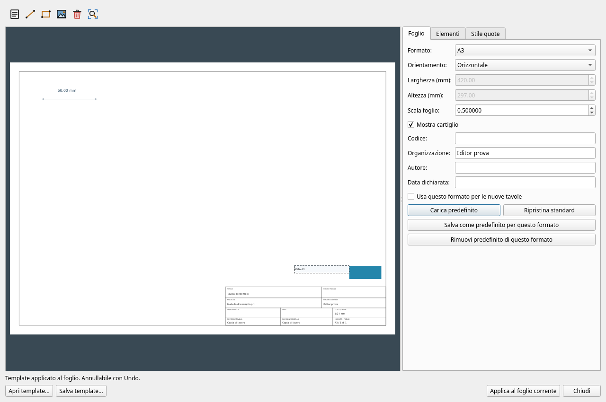
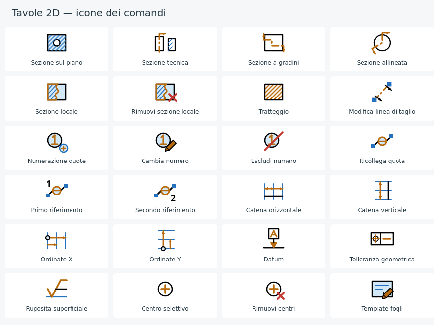

# CT0578: prestazioni tavole 2D, icone e template — 14 novembre 2026

Richiesta: velocizzare apertura di CT0578.drw, differenziare le icone 2D e creare template predefiniti per formato/orientamento.

## Risultato misurato

Confronto sullo stesso CT0578, due esecuzioni per variante in processi distinti, senza compilazioni concorrenti, quattro worker come nell’app. Medie:

| Fase | Prima | Dopo |
| --- | ---: | ---: |
| Lettura | 0,18 s | 0,19 s |
| Preparazione modello/riferimenti | 5,95 s | 6,02 s |
| Preparazione delle 12 viste | 11,83 s | 8,33 s |
| Totale della preparazione | 17,96 s | 14,54 s |

Il calcolo delle viste diminuisce del **29.6%**; il totale diminuisce del **19.0%**.
La verifica finale nella finestra Wayland completa richiede **14,97 s** prima della visualizzazione.
Sono misure di questa macchina con le cache B-rep presenti nel file e le letture ordinarie del filesystem; non sono promesse di tempo su altri hardware.

Il costo principale dopo la preparazione del modello era nella visibilità dei bordi: indice degli occludenti, classificazione e contorni venivano calcolati sull’intero pezzo anche per dettagli piccoli. Le sezioni richiedono circa 150 ms per vista; il tratteggio pochi millisecondi.
Rimane un costo di circa 6 s nella preparazione di genealogia/riferimenti del modello. Controllo separato: 36 feature, 30 B-rep già nella cache; cinque piani e un’elica senza B-rep si preparano in meno di un millisecondo complessivo; la restante preparazione richiede 6100 ms.

La prima profilazione seriale dava 23,9–24,5 s; dopo il ritaglio anticipato 17,6 s. Le medie sopra usano il parallelismo ordinario dell’app.

## Modifiche

- `cad_drawing_preparation.cpp`: curve esatte generate una volta per piano, sorgenti, tagli e tolleranza identici, anche fra dettagli a scale differenti. I worker condividono dati immutabili con `call_once` e riassegnano l’ID della vista. Le barriere di raffinamento della mesh conservano l’ordine precedente.
- `cad_drawing_visibility.cpp`: filtro conservativo XY degli occludenti e dei tratti esterni all’ingombro del dettaglio, prima della classificazione. Margine grafico di 0,1 mm sul foglio prima del ritaglio finale. Curve quotabili, nomi e tolleranze invariati.
- `cad_icons.cpp` e editor: sezioni normale/tecnica/a gradini/allineata/locale distinte, anche nell’albero; icone specifiche per numerazioni, riparazione riferimenti, catene/ordinate, datum, tolleranze e rugosità. Vettoriali QPainter, palette e stato disabilitato dell’app.
- `cad_drawing_frame*`, `cad_drawing_template*`: cartiglio con testi, campi dinamici, linee, rettangoli e PNG incorporati; coordinate in mm ancorate alla cornice, stessa resa in editor e PDF. Foglio schema30 solo per layout personalizzati, compatibilità dei documenti precedenti. Template `.drwt` senza riferimenti al modello, scrittura atomica e limiti coerenti con la lettura.

## Uso dei template

1. Nell’ambiente tavola aprire **File → Template dei fogli...**.
2. Scegliere formato e orientamento; sono disponibili A4–A0 e dimensioni personalizzate.
3. Nella scheda **Elementi** scegliere il testo, campo, linea, riquadro o logo; modificarne posizione/dimensioni o trascinare il riquadro selezionato nell’anteprima. Rotella per zoom; trascinamento del foglio per spostare l’inquadratura.
4. Modificare dati del cartiglio e stile quote. **Salva template...** crea un `.drwt` trasferibile insieme ai loghi incorporati.
5. **Salva come predefinito per questo formato** registra il default separatamente per dimensioni e orientamento. L’opzione del formato iniziale consente di scegliere quello delle nuove tavole.
6. **Applica al foglio corrente** modifica esplicitamente il foglio aperto, annullabile con un solo Undo. I nuovi fogli acquisiscono il proprio default; quelli esistenti conservano i dati salvati.





## Verifiche

- **34/34 CTest pertinenti PASS**, inclusi revisioni/rilasci/ripristino, multifoglio, preparazione concorrente/annullamento, quote e riferimenti, centri/sezione locale, visibilità, dettagli, impaginazione e PDF.
- Dopo l’ultima uniformazione dei limiti del codec: ripetuti **3/3 PASS** per template, multifoglio e pagina.
- Test nuovi `test_drawing_crop.cpp`: occludenti che attraversano il dettaglio, cerchi, sezioni, scale diverse e bordi nascosti; indici conservati, confronto grafico con la classificazione completa.
- Test nuovi `test_drawing_templates.cpp`: codec/PNG, default distinti per formato e orientamento, dati invalidi e downgrade, formati piccoli e template vuoto con revisioni, editor reale, Undo/readonly, PDF e icone distinte.
- CT0578: **47/47 quote Ready**, valori/stati uguali; curve e dati quotabili identici, SHA256 combinata `4a7f6add115d84a29375189ef44639e9d1317720afc7d217a02e0e1a7ecff0ea`.
- Confronto di 24 maschere visibili/nascoste delle 12 viste a 1800×1800: 23 identiche; sul dettaglio E tre pixel differenti, tutti entro un pixel dalla traccia originale. Nessuna differenza oltre tale margine. Avvisi dei contorni identici.
- Provati nuova tavola con formato preferito, nuovo foglio con default diverso e conservazione del foglio esistente.
- Finestra nativa Wayland e [PDF di verifica](../output/CT0578-verifica.pdf) PASS. Avvisi originari del documento conservati: ombreggiatura raster, parte del disegno fuori foglio e precisione grafica di alcuni contorni apparenti. Bordi, sezioni e quote restano esatti.
- App completa e runner applicativo ricompilati. Mappa **714 file / 10280 relazioni / 349 TU**, zero diagnostica; `--check`, uguaglianza HTML/JSON e collegamenti chiamanti/dipendenze verificati nei due versi.
- `git diff --check` PASS. Nessun commit o pubblicazione richiesti/eseguiti.

## Riproduzione e integrità

Prove su copie congelate in `/tmp/ct0578-2d`. Il riferimento salvato nella tavola è `../CT0578.prt`; nel materiale disponibile il modello è adiacente. La copia GUI `CT0578-local.drw` usa quel percorso locale, dopo verifica di identità e impronta della definizione. Gli originali non sono stati modificati.

```sh
cmake --build forgecad-release --target forgecad forgecad_view_tests -j 4
ctest --test-dir forgecad-release -R 'forgecad_.*drawing.*' --output-on-failure -j 2
python3 tools/generate_architecture.py --build-dir forgecad-release --jobs 4
python3 tools/generate_architecture.py --check
```

Diagnostica già disponibile: `forgecad-release/forgecad_view_tests --drawing-performance /tmp/ct0578-2d/CT0578-local.drw`. Mostra i costi delle singole fasi complete e quello dell’editor, che applica l’ottimizzazione dei dettagli. Il confronto completo precedente/ottimizzato e le immagini sono conservati nella cartella temporanea di prova; il riferimento precedente usa la stessa pianificazione dei worker con ritaglio tardivo e senza condivisione delle curve.

SHA256 originali:

- CT0578.drw: `8a930312cd51458a07349177ca78e073594439bce1b8b4f85285e8d75cad83fa`
- CT0578.prt: `7a1767172ed2eab2fd38f7c463cdcdab602bc1af1e5ccd8579ca59dadaf7272c`

Build finale:

- `forgecad`: `117b1f6fe7ee8b2bdbe0453a8151d8e0a6d082bedcc6768e421e5f3975fc479f`
- `forgecad_view_tests`: `49a746be0f8cd32c8ef8b174bebb9d13b6c24ce549fda299b56f932296c90314`

Per usare il nuovo eseguibile occorre riaprire l’applicazione; nessun processo utente è stato chiuso.
