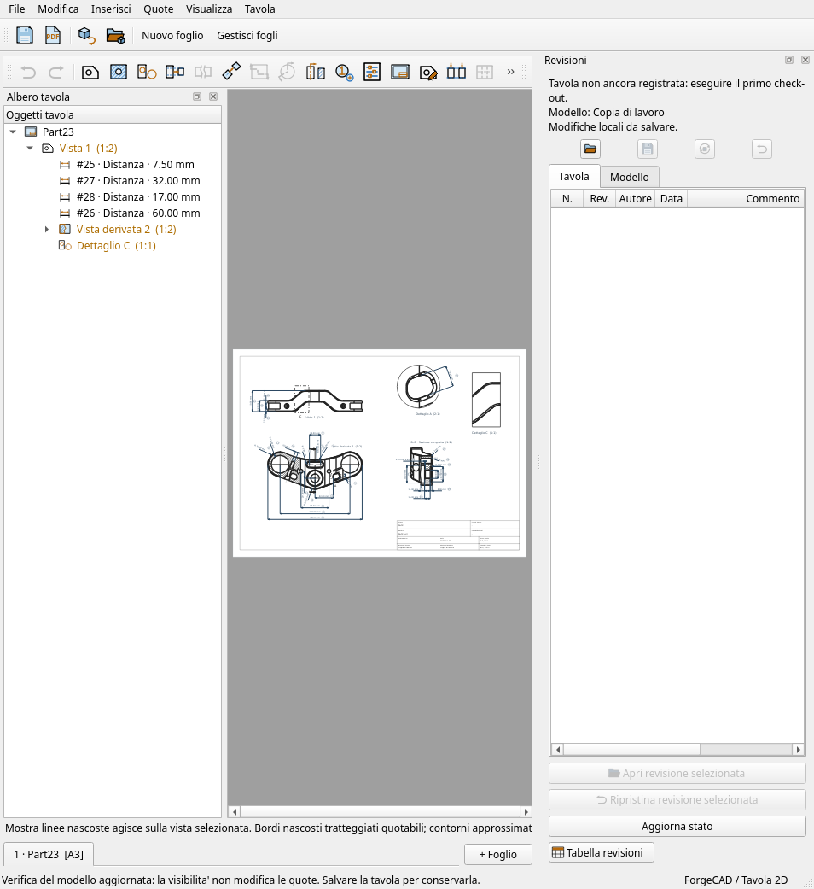

# Part23: recupero delle quote associative — 14 novembre 2026

## Risultato

Part23 torna ad aprirsi con **29/29 quote Ready**, stesso asse, centri, contorni, posizioni e riferimenti persistenti. Nessuna quota e' stata ridisegnata o riagganciata per vicinanza. Gli originali sono stati preservati.

Provati apertura, esportazione PDF, salvataggio della tavola, migrazione del modello alla cache16 e seconda apertura. Il ciclo completo e' riuscito tre volte in processi e workspace di prova indipendenti. Su CT0578 restano **47/47 quote Ready** anche dopo salvataggio e riapertura.

## Cause confermate

1. L'impronta della definizione comprendeva la visibilita' degli schizzi. Nel documento originale basta invertire **solo `sketches[9].visible`** per ottenere esattamente l'impronta registrata nella tavola, `eda747c005d690e7e62788cfdb541c01ceaff40f4131716750a7afc3b72f8ca6`. La geometria non era cambiata. Il precedente messaggio sul modello modificato, interpretato nel primo intervento come modifica geometrica, era fuorviante; l'editor lasciava indisponibile la sorgente e quindi tutte le quote.
2. La vecchia cache conteneva dichiarazioni di provenienza incomplete per **Specchio16**, una ripetizione della funzione. Sul medesimo B-rep alcune facce perdevano il nome `f16:cap.*` e venivano inferite come `f1:cap.*`; i nomi derivati dei bordi non corrispondevano piu' a quelli salvati nelle quote. Il difetto si propagava alle feature successive. La ricostruzione completa recuperava tutte le 29 quote e produceva solidi identici bit per bit a ogni stadio.
3. Una cache parziale faceva scegliere a `normalizeModelHistory` un tip intermedio durante il calcolo dell'impronta. Anche questa disponibilita' temporanea della geometria non deve cambiare l'identita' della definizione.

SHA256 del B-rep finale, identica fra snapshot originale e ricostruzione: `932fb83eaa21e12aeda5c8d6825befb052dd812e51572e76af53181a287f523b`.

## Correzioni

- `cad_drawing_file.cpp`: nuova impronta indipendente dalla visibilita' di schizzi, feature e corpi; i B-rep runtime vengono esclusi prima della normalizzazione, evitando il tip intermedio delle cache parziali. Quote, parametri, precisione e riferimenti topologici restano parte dei controlli pertinenti.
- Compatibilita' con le impronte precedenti: verifica della firma completa nel formato corrente, anche invertendo un singolo flag storico di visibilita'. Non vengono scartate differenze parametriche o di precisione. Per vecchie firme con piu' cambi di visibilita' non riconoscibili dalla verifica esatta rimane necessario l'aggiornamento esplicito; le nuove firme sono indipendenti da qualsiasi combinazione di questi flag.
- `cad_drawing_window.cpp`: migrazione dell'impronta verificata, dopo l'installazione dell'editor e la verifica dell'accesso effettivo; stato modificato e storia del foglio coerenti, conservazione attraverso Salva.
- `cad_document_io.cpp/.h`: **cache16**, definizione nativa sempre69. Nelle vecchie copie di lavoro vengono rigenerate le sole ripetizioni di funzione e i loro derivati; gli stadi precedenti e indipendenti conservano gli snapshot. I check-in archiviati mantengono gli snapshot immutabili.
- `tests/test_drawing_multisheet.h`: visibilita' multipla, compatibilita' della vecchia firma, rifiuto di modifiche geometriche e di precisione, cache parziale con tip intermedio, migrazione selettiva15/16, nomi e B-rep invariati, riapertura reale con quote.
- Test di cache dichiarata e revisioni aggiornati a verificare il formato corrente16; i controlli su payload, definizioni e snapshot restano attivi.

Per evitare di ripetere la migrazione a ogni caricamento, salvare il modello 3D con l'app aggiornata; salvare poi la tavola per conservarne la nuova impronta. Nessun file originale e' stato risalvato automaticamente.

## Verifiche

- Applicazione completa e runner applicativo ricompilati.
- **34/34 CTest delle tavole PASS**.
- **8/8 verifiche di persistenza PASS**, incluse lettura, precisione, cache dichiarata, storia delle ripetizioni, revisioni native/workspace, compressione e multifoglio (quest'ultimo e' anche nella suite2D).
- Part23 Wayland: 29/29 quote e asse Ready; migrazione della firma salvata e riapertura della cache16 PASS. Tre cicli completi in workspace indipendenti: circa20–21s complessivi per ciclo, comprendenti due aperture, PDF e salvataggio del modello; misure sotto altro carico, non benchmark.
- CT0578 Wayland: 47/47 quote e asse Ready; salvataggio e riapertura PASS. La prima migrazione di vecchie cache comporta una rigenerazione; non e' un confronto di prestazioni con le precedenti misure a cache pronta.
- Mappa architetturale: **714 file / 10287 relazioni / 349 TU**, zero diagnostica; `--check` PASS, dati HTML/JSON identici, chiamanti e dipendenze del codec verificati.
- `git diff --check` PASS. Nessun commit/push o chiusura di processi utente.

Le prove con copie che conservano gli stessi UUID vanno eseguite in workspace separati; i primi tentativi con metadata condivisi non certificavano tale isolamento. I tre cicli indipendenti finali mantengono tutte le quote.

Restano gli avvisi gia' presenti sulla precisione grafica dei contorni apparenti e su un taglio locale che non attraversa materiale nel proprio contorno. Non sono stati soppressi; nel PDF finale non compaiono quote scollegate.



[PDF della copia verificata](../output/Part23-quote-ripristinate.pdf)

## Integrita' e riproduzione

Copie, programmi diagnostici e log: `/tmp/drawing-reference-recovery-2026-11-14`.

- Part23.prt: `90577c6d772d1841581ac1b06ef9ddbbad5b7efedd06faa4bef52a1e269099f6`; invariato: True.
- Part23.drw: `206eec7aefe319e69a403205f45a9e5a95fc2e9502e8cf1f66c7f9bd13b313ca`; invariato: True.
- CT0578.prt: `7a1767172ed2eab2fd38f7c463cdcdab602bc1af1e5ccd8579ca59dadaf7272c`; invariato: True.
- CT0578.drw: `8919196fdf43c92e0685e03704b6bb4389ab0c1b7713e276bec49ca9eecb7e05`; invariato: True.

Build finale:

- forgecad: `7ccf811cb8158932b0f6092bc6a1990a4e56aa7cd0f06e651971624d986ddfb5`
- forgecad_view_tests: `e05dab8ddc9e4876c85fcbf0232268ef22efe5fbb0d3b0cc0e12704b9f360828`

```sh
ctest --test-dir forgecad-release -R 'forgecad_.*drawing.*' --output-on-failure -j 2
ctest --test-dir forgecad-release -R '^forgecad_(document_read|document_precision|declared_history_cache|pattern_legacy_history|native_revisions|workspace_revisions|document_compression|drawing_multisheet)_tests$' --output-on-failure -j 2
python3 tools/generate_architecture.py --check
```
