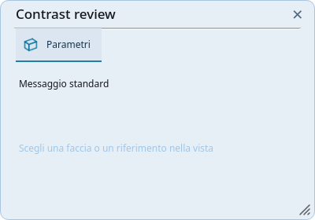

# Review UI — 15 novembre 2026

**Aggiornamento successivo:** UI1–6 corretti e verificati. Per UI2 viene consentito un solo comando modeless fra documenti; consultazione e cambio scheda restano disponibili. [Implementazione, prove e limiti](../review-fix-next-2026-11-15.md). Il testo seguente conserva lo stato della review iniziale.

Ambito della review: interfaccia 3D/pannelli comuni, selezione, temi e contenitore schede. Consultati AGENTS.md, CLAUDE.md e descrizioni/collegamenti in docs/architecture/graph.json. Nessuna modifica ai sorgenti, preferenze o CAD utente. Harness eseguito in `/tmp/forgecad-review-20261115/ui`; sorgenti e log conservati anche in `prove/ui-repro.cpp.txt`, `prove/ui-build.py.txt` e `prove/ui-repro.log`.

## UI1 — P2 — Riempimento interpreta coefficienti adimensionali come lunghezze

- Posizione primaria: `forgeCad2026_dialogs_surfaces.cpp:1646-1659`, altri campi a `1676-1678`.
- Trigger: aprire Riempimento con documento in centimetri/pollici/metri; immettere `1` per influenza della faccia, peso delle guide o influenza interna.
- Causa: tutti e tre sono ExpressionSpinBox con lengthMeasurement=true di default; manca setLengthMeasurement(false). `cad_expression.cpp:363-376` converte il testo in millimetri anche se qui il valore è un fattore, poi il pannello lo copia in fillFaceInfluences/fillGuideWeight/fillShapeWeight (`1766`, `1790`, `1841-1843`).
- Impatto: in cm un coefficiente 1 viene mostrato 0.100 cm, digitare 1 diventa 10; in pollici il fattore è 25.4. Cambia la geometria/tensione, può attivare limite massimo o rendere il valore naturale 1 non inseribile in unità grandi. In mm resta almeno il suffisso dimensionalmente sbagliato.
- Confronto: SurfaceEndControls imposta esplicitamente setLengthMeasurement(false) (`forgeCad2026_dialogs_common.cpp:1504-1508`), così come Scala (`forgeCad2026_dialogs_solids.cpp:270`).
- Prova: pannello reale `fillDialog`, unità cm, tre controlli letti nell'event loop: `isLength=1 text=0.100 cm typed1=10` per ognuno. Nessuna feature salvata o kernel deformato: prova del parsing e del widget di produzione, passaggio ai parametri verificato staticamente.
- Correzione proposta: rendere adimensionali i tre controlli prima di inizializzarli; regression su mm/cm/in mantenendo invariati i coefficienti.

## UI2 — P2 — Pannelli in due schede: una funzione chiusa resta bloccata finché si chiude l'altra

- Posizione primaria: `forgeCad2026_dialogs_common.cpp:1615-1619` (`runModeless`); `WindowLock::~WindowLock` a `225-230`.
- Trigger: aprire un pannello A in documento A, cambiare scheda, aprire pannello B nel documento B, tornare ad A e premere Annulla/Conferma prima di chiudere B.
- Causa: l'event loop locale di B è annidato dentro A. `finished(A)` invoca quit del loop A, ma lo stack di A non può tornare e distruggere WindowLock fino all'uscita di B. Lo stato A rimane interactionLocked=true, menu/toolbar/azioni restano disabilitati anche con pannello A chiuso.
- Impatto: il documento A appare bloccato senza comando aperto. La pulizia dei picker/anteprima che avviene dopo il runner viene ritardata allo stesso modo. Non è un deadlock permanente: chiudendo B si sblocca A, ma l'indipendenza dei documenti non è rispettata.
- Prova: vero `DocumentTabsWindow` con due workspace QMainWindow+CadViewport, pannelli FunctionDialogPanel e runner di produzione; sequenza di attivazione schede+reject tramite QTimer. Output: `tabs A cancelled hidden=1 A locked=1 B pending=1`, dopo reject B: `tabs after B cancelled A locked=0`.
- Limite: provato il ciclo degli oggetti UI/offscreen, non una sequenza di clic desktop né un'operazione kernel concreta. La raggiungibilità è confermata dal contenitore che permette il cambio scheda (`cad_document_tabs.cpp:179-200`), mentre WindowLock opera sul solo workspace (`197-222` del common).
- Correzione proposta: lifecycle asincrono legato a finished e rilascio del blocco in quel segnale, o impedire esplicitamente un secondo runner annidato cross-document; evitare di lasciare cleanup esclusivamente al ritorno del loop.

## UI3 — P2 — Annulla in riempimento/rivestimento lascia attivo un picker senza callback

- Posizione primaria: `forgeCad2026_dialogs_mapping.cpp:99-100` e `445-446`.
- Trigger: Riempimento pattern → Scegli contorno nella vista → Annulla; equivalente nella scelta di facce di Sviluppo/Rivestimento.
- Causa: cleanup cancella refPickFinished_ e marks ma non chiama cancelReferencePick. BodyPicker::~BodyPicker chiama cancel solo quando il picker del corpo è active_; qui è attiva la scelta separata di contorno/faccia. PreviewScope::~PreviewScope non cancella referencePicking.
- Impatto: viewport sbloccato ma refPicking_=true; il primo clic su geometria entra nel ramo di selezione riferimento (`forgeCad2026_viewport_interaction.cpp:224-234`), viene assorbito senza callback e non esegue la normale selezione. In modifica può permanere il contesto storico del picker finché si preme Esc o si prende un riferimento.
- Prova: pannello reale fillPatternDialog, pulsante reale `fillPatternBoundaryPick`, poi reject: `fill during pick=1`, `fill after cancel pick=1 lock=0`.
- Confronto: Proiezione pulisce cancelReferencePick/callback/marks in finished (`forgeCad2026_dialogs_projection.cpp:187-189`); Poli e altri pannelli chiamano cancel esplicitamente.
- Correzione proposta: cleanup RAII o collegamento finished sempre completo, indipendente dal picker attivo.

## UI4 — P2 — Cambio G1 facce/piano → G0 mantiene un picker attivo con pulsante disabilitato

- Posizione primaria: `forgeCad2026_dialogs_common.cpp:1566-1575` (`SurfaceEndControls::sync`).
- Trigger: Loft/Rigata, attivare Scegli facce nel vincolo di estremità G1 a faccia e, senza finire la selezione, scegliere G0; analogo cambiando tra ruolo piano e faccia.
- Causa: sync aggiorna modo/abilitazione/pulsante, senza azzerare active_ o cancelReferencePick. Il ruolo attivo del viewport resta quello precedente; la callback continua a riarmare la scelta (`1585-1606`).
- Impatto: resta un pulsante checked ma disabled e la vista continua a consumare clic per un riferimento che il modo G0 non usa. Occorre Esc o riabilitare una continuità che consenta il pulsante. Nel cambio piano→faccia rimane anche il filtro di scelta del ruolo precedente sino al primo pick.
- Prova: componente reale SurfaceEndControls con `loftDialog`; attiva G1facce, click Scegli, cambio G0. Output: `surface end after G0 pick=1 buttonEnabled=0 checked=1`.
- Confronto: Taglia (`forgeCad2026_dialogs_trim.cpp:380-388`) ferma tutti i picker e cancella la scelta al cambio modalità.
- Correzione proposta: fermare/riarmare esplicitamente il picker quando cambia il modo o il suo ruolo.

## UI5 — P2 — Messaggi di stato/errori quasi illeggibili nel tema chiaro

- Posizione primaria: `forgeCad2026_dialogs_common.cpp:1133-1135` e `1181-1183`; esempi per stato/istruzioni in `forgeCad2026_dialogs_trim.cpp:122,133`, `forgeCad2026_dialogs_sketch.cpp:328,667,748,854`, `forgeCad2026_dialogs_surfaces.cpp:1687,1701` e vari pannelli solidi.
- Trigger: tema Chiaro (o Desktop chiaro), aprire Taglia/Riempimento/Piani e leggere istruzioni/esito/errore; opacità 100% è già sufficiente e non dipende da sfondo 3D.
- Causa: setStyleSheet locali forzano azzurro #9fc6e8, verde #8ee8a2, salmone #ff7b72; i colori sopravvivono all'aggiornamento palette e sovrascrivono il testo scuro della base FunctionDialogPanel.
- Prova: FunctionDialogPanel/FunctionMessage reali, stessa regola QSS del prodotto, palette light e opacità 100%; palette testo standard #14181d, testo locale #9fc6e8, fondo #e6eef6. Contrasti calcolati: standard 15.22:1, stato 1.53:1, verde 1.26:1, errore 2.15:1. Immagine `contrast-light.png` ispezionata visivamente.
- Confronto: testo ordinario e `functionPreviewMessage` seguono palette/PlaceholderText, mentre gli stati locali restano fissati al tema scuro.
- Limite: screenshot del componente comune con colori esatti ripresi dai sorgenti, non cattura di tutti i dialoghi reali né certificazione grafica Wayland/macOS/desktop nativo. Nessuna obiezione estetica: problema misurato di leggibilità.
- Correzione proposta: ruoli semantici di stato/errore dipendenti dal tema centralizzati, aggiornati insieme alla palette.

## UI6 — P3 — Refresh delle liste perde la selezione multipla senza cambi ai riferimenti

- Posizione primaria: `forgeCad2026_dialogs_common.cpp:1278-1297` (`GeometryReferenceList::setReferences`).
- Trigger: selezionare due facce in una lista Mapping/Riempimento, cambiare un parametro che aggiorna l'anteprima, premere Rimuovi.
- Causa: si salva soltanto currentRow, poi clear() e setCurrentRow ripristinano una sola selezione. I chiamanti usano ExtendedSelection (`forgeCad2026_dialogs_mapping.cpp:57,137,144`) e richiamano setReferences a ogni refresh (`72,261,265`), anche quando i riferimenti sono identici.
- Impatto: rimozione/evidenziazione agisce soltanto sull'ultima voce anziché sul gruppo selezionato; comportamento incoerente con la selezione multipla esposta dalla UI.
- Prova: GeometryReferenceList reale, due riferimenti alle facce del box, due selectedItems; setReferences con identico vettore: `multiselect before refresh=2`, `multiselect after same references=1`.
- Correzione proposta: preservare tutti i riferimenti selezionati e current separatamente, evitare reset quando la lista non cambia.

## Prove, copertura e limiti

Comando eseguito con preferenze temporanee isolate:

```sh
QT_QPA_PLATFORM=offscreen QT_QPA_PLATFORMTHEME=generic QT_STYLE_OVERRIDE=Fusion timeout 40s /tmp/forgecad-review-20261115/ui/repro
```

- `repro.cpp` e `build.py` collegano gli oggetti esistenti del runner `forgecad_view_tests` sostituendo solo il suo main con il probe; oggetti common/mapping/surfaces/tabs/expression controllati più recenti dei relativi sorgenti. Nessuna build o scrittura nel repository.
- `repro.log`: output completo delle riproduzioni; ultimo exit 0.
- `contrast-light.png`: unica cattura, widget comune senza OpenGL.
- Lettura mirata di tutti i moduli forgeCad2026_dialogs*, common/theme e cad_document_tabs, tracciamento callback in viewport_selection/interaction, confronto con test_function_panels e test_application_theme. Non è revisione riga-per-riga delle circa 20.000 righe UI; tavole 2D/menu dinamici e geometrie avanzate non completamente coperte.
- Nessuna certificazione OpenGL/Wayland/XCB/macOS né leak GUI misurato. Nessun processo utente/manufatto originale toccato.
- Piste scartate: chiusura semplice della scheda durante comando è protetta da interactionLocked in PdfWindow::closeEvent; angoli impostati via ExpressionSpinBox::setSuffix disabilitano già la conversione lunghezza; smusso ripristina esplicitamente setLengthMeasurement(true); menu tema risincronizza le spunte su aboutToShow. Non riportati come bug.

## Cattura conservata


