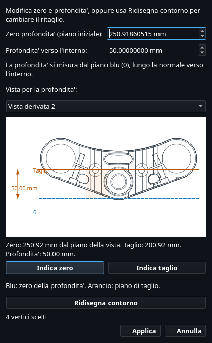

# Guida visiva della profondità delle sezioni locali — 14 novembre 2026

## Uso

Selezionare la vista e aprire **Inserisci → Sezione locale…**. Il pannello mostra una vista ortogonale della stessa sorgente; se ce ne sono più di una, si può scegliere **Vista per la profondità**.

- **Linea blu tratteggiata, 0:** piano iniziale da cui viene misurata la profondità.
- **Linea arancione, Taglio:** piano effettivo della sezione, con distanza e frecce tra i due piani.
- La fascia trasparente indica l'intervallo tra zero e taglio limitato all'estensione del contorno locale.
- I piani si aggiornano immediatamente cambiando i valori. Il riepilogo distingue le coordinate rispetto al piano della vista dalla profondità relativa allo zero.
- **Indica zero** e **Indica taglio** permettono di scegliere la posizione con un clic nell'anteprima o nella vista corrispondente del foglio. Un taglio esterno rispetto allo zero viene rifiutato, mantenendo attiva la scelta.
- **Applica** conferma la sezione; **Esc/Annulla** elimina le guide e conserva la tavola precedente. Il contorno non riceve vertici durante la scelta dei piani.

Le guide appaiono anche direttamente sulla vista ortogonale nella tavola. Quando manca una vista idonea, il pannello crea una **vista ortogonale d'appoggio** temporanea, senza aggiungere una vista al documento. Le viste di riferimento devono avere le stesse sorgenti e una normale perpendicolare; dettagli ritagliati e viste interrotte sono esclusi per evitare di rappresentare la profondità in coordinate grafiche deformate.

## Implementazione

- `cad_drawing_local_section_depth.h/.cpp`: scelta delle viste, proiezione analitica di appoggio, trasformazioni tra piani e scale in `double`, piani zero/taglio, fascia e quota, selezione con mouse, pannello e guide temporanee.
- `cad_drawing_local_section_tool.h/.cpp`: campi collegati alla guida, scelta dello zero/taglio, testo esplicito del riferimento, conferma e annullamento, pannello con riepilogo leggibile.
- `cad_drawing_editor.cpp`: trasferisce i profili ortogonali già presenti nella cache e le sorgenti della vista allo strumento. La scelta dei piani non modifica lo stato o la storia della tavola.
- `CMakeLists.txt`: nuovo modulo nell'applicazione e nei runner; nuovo test autonomo `forgecad_drawing_local_section_depth_tests`.
- `tools/generate_architecture.py`: descrizioni del nuovo modulo e delle nuove prove.

Il piano geometrico rimane **front − depth** lungo la normale della vista sezionata. I clic vengono riportati a questa coordinata mediante i frame e la scala della vista ortogonale. Le guide non sono riferimenti quotabili, non vengono salvate o esportate e scompaiono alla chiusura dello strumento. Nessun cambiamento di codec, nomi topologici o kernel. L'anteprima d'appoggio riusa la proiezione B-rep e i contorni analitici esistenti; il campionamento riguarda soltanto il profilo grafico. Le variazioni dei valori aggiornano le guide senza generare sezioni, mesh o visibilità.

## Verifiche

- Nuova regressione: **18 combinazioni** di frame ruotati, assi invertiti e scale; coordinate dei due piani e distanza fisica corrette; rifiuto di riferimenti paralleli.
- Selezione di viste della stessa sorgente, anche con sorgenti elencate in ordine diverso; esclusione di altri corpi, viste parallele, dettagli e interruzioni. Anteprima senza vista ortogonale e generatrice apparente di un cilindro.
- Interazione Qt: aggiornamento dei campi e cambio di vista, clic su foglio e anteprima, rifiuto di taglio esterno, riepilogo visibile fuori dal riquadro grafico, contorno invariato, nessuna modifica/ricalcolo prima di Applica, Esc, rimozione delle guide, quote conservate e singolo Undo. Prove offscreen e Wayland PASS.
- Applicazione completa, runner viewport e runner 2D ricompilati. **35/35 CTest 2D PASS**, 35,98 s sull'ultimo codice.
- Ultimo Part23 congelato: **5 viste, 4 sezioni locali, 30 quote, 1 asse, 5 centri**. Guida associata automaticamente a Vista derivata 2. Apertura della guida **24 ms**, **100 variazioni 273 ms** (prima misura 23/299 ms); puntatore alle curve esatte e foglio serializzato invariati durante l'anteprima. Misure locali, non una garanzia generale di prestazioni.
- Applica da pannello con piano iniziale/profondità traslati insieme, mantenendo il piano geometrico: **30/30 quote pronte e valori invariati**, anche dopo salvataggio e riapertura. Le prove sintetiche di profondità differenti sul materiale e di quota mancante oltre il foro restano nel test delle sezioni locali.
- PNG e PDF nativi generati; CAD originali confrontati con le copie iniziali: invariati. Rimangono gli avvisi geometrici già presenti sui contorni apparenti e su un piano locale che non attraversa materiale entro il contorno: distinti dalla guida.
- Architettura: **717 file, 10319 relazioni, 351 TU**, zero diagnostica; rigenerazione, `--check`, HTML/JSON equivalenti e chiamanti/dipendenze nei due versi PASS. `git diff --check` PASS.

App SHA256: `81d9497549f368006a82d37781bc915cfaee884941ad665d267e5ad50d2f7ef5`.
Runner SHA256: `54d0473e71a66594e525d973e370260dd5587305c63391630281597761fc627b`.

Part23.drw originale: `9a512760b4b5c6a9e8eb5b267c9d97eaa987c6bb4da210195c9130a758f8d6a6`.
Part23.prt originale: `90577c6d772d1841581ac1b06ef9ddbbad5b7efedd06faa4bef52a1e269099f6`.

Dati, riproduttore, log e copie: `/tmp/local-section-depth-2026-11-14/`. Per utilizzare i binari aggiornati riavviare ForgeCAD.

Riferimenti: [comandi iniziali](tavole-centri-raggi-sezione-locale-2026-11-14.md), [modifica delle sezioni quotate](sezione-locale-quote-modifica-2026-11-14.md), [precedente memoria completa](history/claude-prima-guida-profondita-2026-11-14.md).

Aggiornamento successivo: [snap nella scelta di zero e taglio](sezione-locale-snap-profondita-2026-11-14.md), con indicatore, Tab e Alt.
