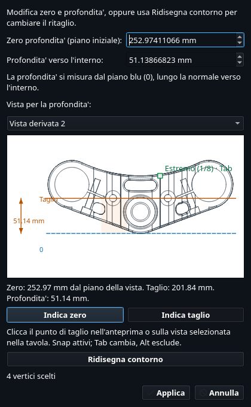

# Snap per zero e taglio delle sezioni locali — 14 novembre 2026

## Uso

In **Inserisci → Sezione locale…**, i comandi **Indica zero** e **Indica taglio** ora agganciano estremi, punti medi, centri, quadranti e punti sui bordi. Funzionano nella vista ortogonale sulla tavola, nell'anteprima e nella vista d'appoggio quando non esiste un'ortogonale nella tavola.

Un indicatore verde mostra punto e tipo di snap prima del clic. I punti notevoli hanno priorità sul bordo; **Tab** sceglie tra gli agganci vicini e **Alt** permette il punto libero. Il raggio è di 9 pixel e segue lo zoom. Il clic usa lo stesso punto mostrato dall'indicatore, incluso quello selezionato con Tab. Gli indicatori spariscono alla conferma, all'annullamento, al cambio di vista o all'uscita del puntatore.

## Implementazione

- `cad_drawing_local_section_snap.h`: cache dei punti notevoli e dei bordi delle curve geometriche esatte, con box per limitare le proiezioni ai bordi vicini. Estremi e medi rispettano anche le proiezioni lineari dei cerchi visti di taglio; i cerchi chiusi non generano un falso vertice alla cucitura. I quadranti sono verificati sul tratto effettivo dell'arco. Le posizioni sui bordi sono proiezioni sulle rette/curve, indipendenti dal campionamento del disegno.
- `cad_drawing_local_section_depth.h/.cpp`: dati geometrici riusati delle viste, snap e feedback in entrambe le superfici di lavoro, Tab/Alt, filtro dei riferimenti mostrati e pulizia degli indicatori. Le curve della vista d'appoggio alimentano la stessa cache.
- `cad_drawing_local_section_tool.h/.cpp` e `cad_drawing_editor.cpp`: inoltrano i modificatori della tastiera, la scala del canvas e le curve già calcolate; il filtro usa la visibilità già presente nella tavola. Nessun ricalcolo della sezione durante la scelta.
- `tests/test_drawing_local_section_depth.cpp`: regressioni geometriche e interazione con mouse/tastiera; le prove dei punti liberi usano esplicitamente Alt.
- `tools/generate_architecture.py`: catalogo e collegamenti del modulo aggiornati.

Solo il raggio di ricerca è grafico. Il valore del piano deriva dalle coordinate in `double` del punto geometrico. I campi conservano la loro precisione di otto decimali. Non vengono aggiunti legami persistenti al modello o modificati nomi topologici, geometria, formati dei documenti o tolleranze del kernel.

## Verifiche

- Geometria: estremi/medi di segmento obliquo in un frame ruotato, tre scale, piano della curva traslato rispetto alla vista, centro/quadranti e proiezione sul cerchio, quadranti esclusi dall'arco rifilato, raggio in pixel e geometrie non mostrate escluse.
- Qt: indicatore prima del clic, coordinate esatte dello zero e della profondità su tavola e anteprima, punto medio nell'appoggio, scelta Tab confermata senza salto, Alt e punto libero, pulizia all'uscita/Esc, foglio e puntatori alle curve invariati durante gli snap. Offscreen e Wayland PASS.
- Applicazione completa, runner viewport e runner tavole ricompilati. **35/35 CTest 2D PASS**, 37,46 s.
- Part23 su una copia aggiornata e workspace isolato: cinque viste, quattro sezioni locali, trenta quote, un asse e cinque centri. Apertura della guida **39 ms**, cache di **1837 punti notevoli**; snap dello zero sul foglio e del taglio nell'anteprima verificati confrontando campo e coordinata esatta dell'indicatore. **100 variazioni della profondità: 267 ms**, senza modificare il foglio o rigenerare le curve. Sono misure locali, non una garanzia generale.
- Applica dopo aver ripristinato i parametri della prova e spostato insieme piano iniziale/profondità: **30/30 quote collegate e valori invariati**, anche dopo salvataggio e riapertura. Esportazione PDF e PNG riuscite. Rimangono gli avvisi geometrici già documentati sui contorni apparenti e sul piano locale senza materiale: distinti dagli snap.
- Mappa delle dipendenze: **718 file, 10333 relazioni, 351 TU**, zero diagnostica. Rigenerazione, `--check`, equivalenza HTML/JSON e chiamanti/dipendenze nei due versi PASS. `git diff --check` PASS. Originali confrontati byte per byte con le copie iniziali: invariati.

App SHA256: `65c49d3a4671d9cb7073bac9308088f08aeffee26831bf7e5855551d1b785cf5`.
Runner SHA256: `b3576ff473bd0b54afb026eebc054a9f0ecdd2f56a49b4700eff23f3785548ad`.

Copia iniziale Part23.drw: `84f80676cb9801200c0227ac56ac59692389c505c162018493cebd4fe70d7932`.
Copia iniziale Part23.prt: `90577c6d772d1841581ac1b06ef9ddbbad5b7efedd06faa4bef52a1e269099f6`.
Le prove scrivono soltanto in `/tmp/local-section-depth-snap-2026-11-14/`; nessun CAD originale viene scritto.

Per utilizzare l'app aggiornata occorre riavviare ForgeCAD. [Guida visiva e verifiche precedenti](sezione-locale-guida-profondita-2026-11-14.md).
